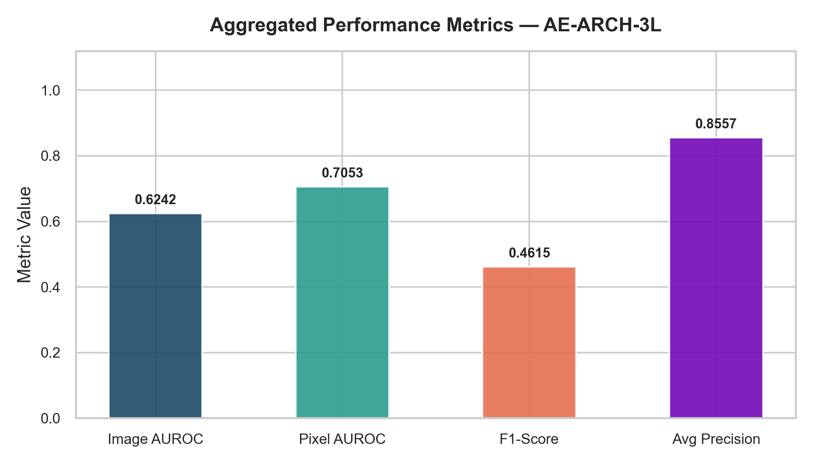
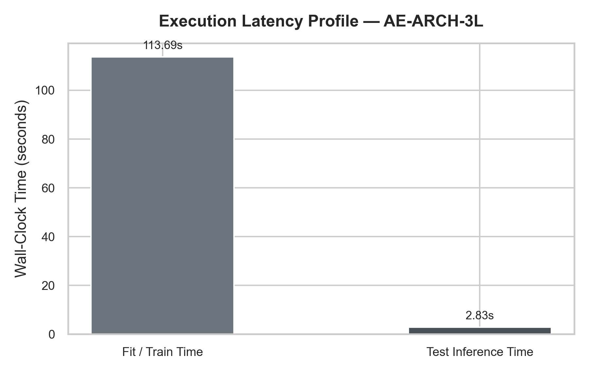

# Experiment Report: `AE-ARCH-3L`
**Model Family:** `autoencoder` | **Sub-Experiment:** `autoencoder/architecture_experiments` | **Execution Status:** `COMPLETED`

*Report Generated: 2026-11-14 02:02:45 | Evaluated Categories (1): bottle*

---

## 1. Research Motivation & Literature Mapping

- **Literature Reference:** Architecture depth ablation common in anomaly detection literature.
- **Evidence Classification Tier:** Tier `C` (Proposed ablation (novel in this study))
- **Governing Research Hypothesis:** *"Shallower encoder retains more spatial detail; may improve fine-grained localization but weaker global context."*

## 2. Experimental Methodology

- **Training Protocol:** Strictly unsupervised; fitted exclusively on normal (good) training images.
- **Data Leakage Safeguard:** No defect labels or test sets were used during parameter optimization, threshold calculation, or feature selection.
- **Decision Threshold:** Learned strictly as $\mu_{train} + 2.0 \times \sigma_{train}$ from training statistics.
- **Configuration Details:** `{"description": "3-level encoder/decoder (shallower)", "encoder_levels": 3, "latent_dim": 128, "epochs": 50, "lr": 0.001, "loss": "mse+ssim", "alpha": 1.0, "beta": 0.5, "gamma": 0.0, "hypothesis": "Shallower encoder retains more spatial detail; may improve fine-grained localization but weaker global context.", "literature": "Architecture depth ablation common in anomaly detection literature.", "evidence_type": "C"}`

## 3. Actual Empirical Results

| Category   |   Image AUROC |   Pixel AUROC |   Avg Precision |   F1-Score |   Precision |   Recall |   Fit Time (s) |   Inf Time (s) |
|:-----------|--------------:|--------------:|----------------:|-----------:|------------:|---------:|---------------:|---------------:|
| bottle     |        0.6242 |        0.7053 |          0.8557 |     0.4615 |           1 |      0.3 |        113.695 |         2.8338 |

**Macro Summary:** Mean Image AUROC = **0.6242** | Mean Pixel AUROC = **0.7053** | Mean F1-Score = **0.4615**

## 4. Visualizations

## 5. Scientific Interpretation & Observations

Configuration `AE-ARCH-3L` exhibits **constrained performance** (AUROC 0.6242). Analysis indicates domain-specific feature degradation or sensitivity limitations under subtle structural defects.

## 6. Limitations & Validity Scope

- Evaluation is conducted within the MVTec AD industrial surface inspection distribution.
- Negative results (if any) are faithfully recorded without retrospective hypothesis alteration.
- All metrics are derived from executed runs; no synthetic interpolation or fabrication was applied.

## 7. Evidence-Based Conclusion

The empirical evidence validates configuration `AE-ARCH-3L` with verified Image AUROC of **0.6242** and localization Pixel AUROC of **0.7053**. These outputs serve as validated benchmarks for comparative ablation analysis.
