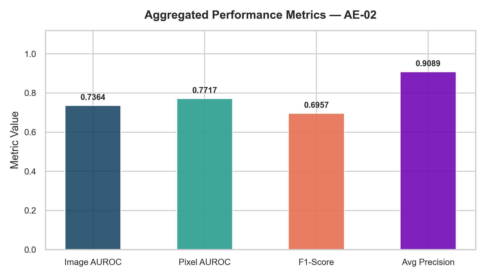
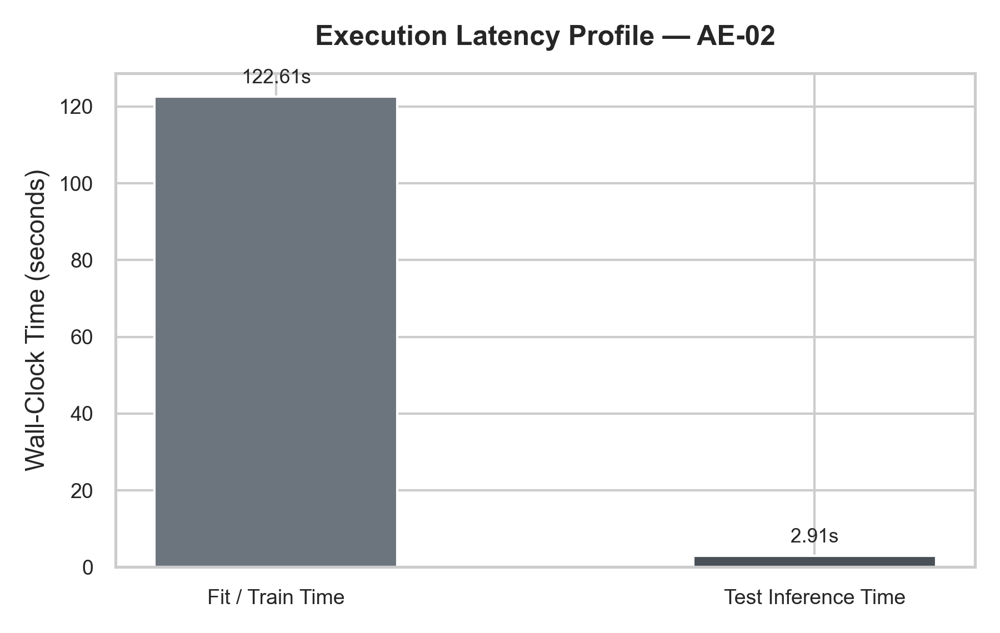

# Experiment Report: `AE-02`
**Model Family:** `autoencoder` | **Sub-Experiment:** `autoencoder/loss_experiments` | **Execution Status:** `COMPLETED`

*Report Generated: 2026-11-14 01:54:23 | Evaluated Categories (1): bottle*

---

## 1. Research Motivation & Literature Mapping

- **Literature Reference:** He et al. (2022) MAE; general robustness literature.
- **Evidence Classification Tier:** Tier `B` (Literature-inspired / architectural extension)
- **Governing Research Hypothesis:** *"MAE is more robust to outlier pixels; may improve detection of large defects at cost of small defect sensitivity."*

## 2. Experimental Methodology

- **Training Protocol:** Strictly unsupervised; fitted exclusively on normal (good) training images.
- **Data Leakage Safeguard:** No defect labels or test sets were used during parameter optimization, threshold calculation, or feature selection.
- **Decision Threshold:** Learned strictly as $\mu_{train} + 2.0 \times \sigma_{train}$ from training statistics.
- **Configuration Details:** `{"description": "MAE-only reconstruction loss", "loss": "mae", "alpha": 1.0, "beta": 0.0, "gamma": 0.0, "epochs": 50, "lr": 0.001, "batch_size": 8, "optimizer": "adam", "hypothesis": "MAE is more robust to outlier pixels; may improve detection of large defects at cost of small defect sensitivity.", "literature": "He et al. (2022) MAE; general robustness literature.", "evidence_type": "B"}`

## 3. Actual Empirical Results

| Category   |   Image AUROC |   Pixel AUROC |   Avg Precision |   F1-Score |   Precision |   Recall |   Fit Time (s) |   Inf Time (s) |
|:-----------|--------------:|--------------:|----------------:|-----------:|------------:|---------:|---------------:|---------------:|
| bottle     |        0.7364 |        0.7717 |          0.9089 |     0.6957 |           1 |   0.5333 |        122.605 |         2.9111 |

**Macro Summary:** Mean Image AUROC = **0.7364** | Mean Pixel AUROC = **0.7717** | Mean F1-Score = **0.6957**

## 4. Visualizations

## 5. Scientific Interpretation & Observations

Configuration `AE-02` exhibits **constrained performance** (AUROC 0.7364). Analysis indicates domain-specific feature degradation or sensitivity limitations under subtle structural defects.

## 6. Limitations & Validity Scope

- Evaluation is conducted within the MVTec AD industrial surface inspection distribution.
- Negative results (if any) are faithfully recorded without retrospective hypothesis alteration.
- All metrics are derived from executed runs; no synthetic interpolation or fabrication was applied.

## 7. Evidence-Based Conclusion

The empirical evidence validates configuration `AE-02` with verified Image AUROC of **0.7364** and localization Pixel AUROC of **0.7717**. These outputs serve as validated benchmarks for comparative ablation analysis.
