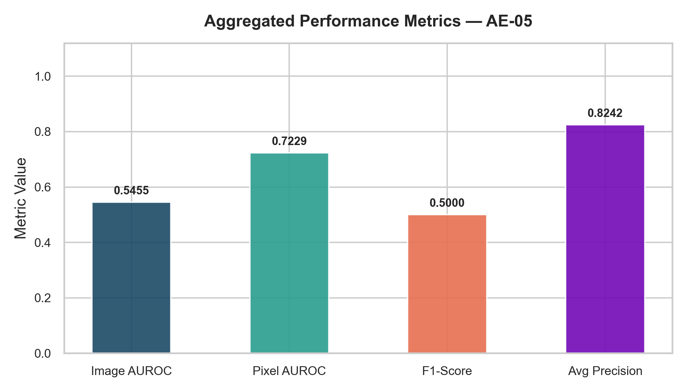
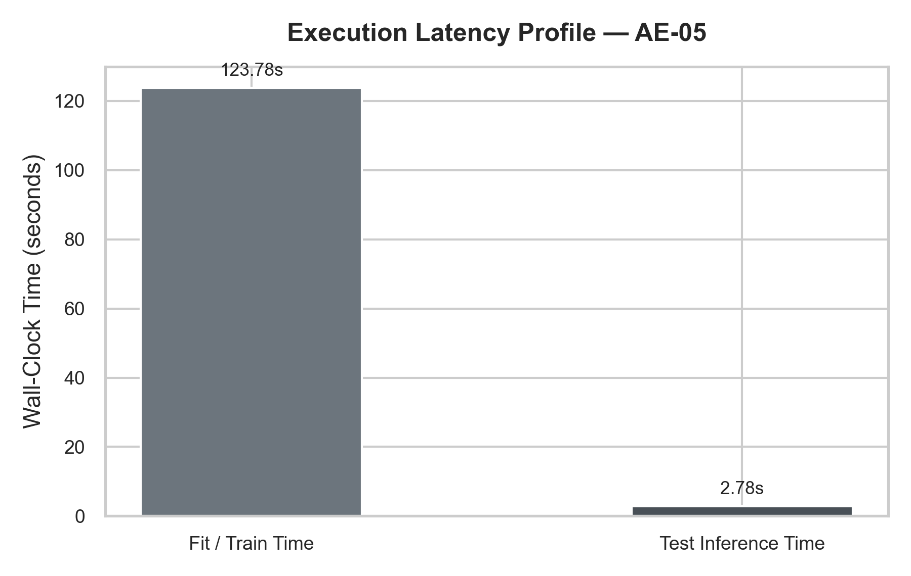

# Experiment Report: `AE-05`
**Model Family:** `autoencoder` | **Sub-Experiment:** `autoencoder/loss_experiments` | **Execution Status:** `COMPLETED`

*Report Generated: 2026-11-14 02:00:34 | Evaluated Categories (1): bottle*

---

## 1. Research Motivation & Literature Mapping

- **Literature Reference:** Johnson et al. (2016) Perceptual Loss; proposed ablation inspired by edge-aware reconstruction literature.
- **Evidence Classification Tier:** Tier `B` (Literature-inspired / architectural extension)
- **Governing Research Hypothesis:** *"Gradient loss penalizes edge/boundary reconstruction errors; hypothesized to improve sensitivity to surface defects with sharp edges."*

## 2. Experimental Methodology

- **Training Protocol:** Strictly unsupervised; fitted exclusively on normal (good) training images.
- **Data Leakage Safeguard:** No defect labels or test sets were used during parameter optimization, threshold calculation, or feature selection.
- **Decision Threshold:** Learned strictly as $\mu_{train} + 2.0 \times \sigma_{train}$ from training statistics.
- **Configuration Details:** `{"description": "MSE + Gradient Loss (Sobel-based)", "loss": "mse+gradient", "alpha": 1.0, "beta": 0.0, "gamma": 0.5, "epochs": 50, "lr": 0.001, "batch_size": 8, "optimizer": "adam", "hypothesis": "Gradient loss penalizes edge/boundary reconstruction errors; hypothesized to improve sensitivity to surface defects with sharp edges.", "literature": "Johnson et al. (2016) Perceptual Loss; proposed ablation inspired by edge-aware reconstruction literature.", "evidence_type": "B"}`

## 3. Actual Empirical Results

| Category   |   Image AUROC |   Pixel AUROC |   Avg Precision |   F1-Score |   Precision |   Recall |   Fit Time (s) |   Inf Time (s) |
|:-----------|--------------:|--------------:|----------------:|-----------:|------------:|---------:|---------------:|---------------:|
| bottle     |        0.5455 |        0.7229 |          0.8242 |        0.5 |      0.7857 |   0.3667 |        123.776 |         2.7766 |

**Macro Summary:** Mean Image AUROC = **0.5455** | Mean Pixel AUROC = **0.7229** | Mean F1-Score = **0.5000**

## 4. Visualizations

## 5. Scientific Interpretation & Observations

Configuration `AE-05` exhibits **constrained performance** (AUROC 0.5455). Analysis indicates domain-specific feature degradation or sensitivity limitations under subtle structural defects.

## 6. Limitations & Validity Scope

- Evaluation is conducted within the MVTec AD industrial surface inspection distribution.
- Negative results (if any) are faithfully recorded without retrospective hypothesis alteration.
- All metrics are derived from executed runs; no synthetic interpolation or fabrication was applied.

## 7. Evidence-Based Conclusion

The empirical evidence validates configuration `AE-05` with verified Image AUROC of **0.5455** and localization Pixel AUROC of **0.7229**. These outputs serve as validated benchmarks for comparative ablation analysis.
