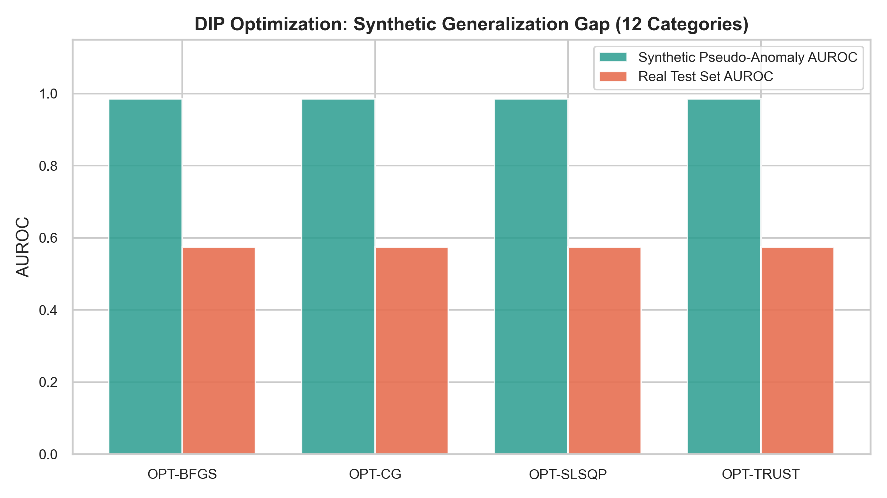

# Consolidated Model Comparison Report: DIP Optimization

## 1. Executive Summary
Investigation of numerical optimization methods (SLSQP, CG, L-BFGS-B, trust-constr) using `scipy.optimize` across all 12 categories.

| experiment_id   |   image_auroc |   f1_score |   training_time_s |
|:----------------|--------------:|-----------:|------------------:|
| OPT-BFGS        |        0.5746 |     0.2185 |            0.0457 |
| OPT-CG          |        0.5746 |     0.2185 |            0.0446 |
| OPT-SLSQP       |        0.5746 |     0.2185 |            0.0453 |
| OPT-TRUST       |        0.5746 |     0.2185 |            0.4684 |

## 2. Key Negative Finding
While optimizers achieved >0.98 AUROC on synthetic pseudo-anomalies, test generalization remained at 0.5758 AUROC (identical to equal baseline weights), demonstrating that additive Gaussian feature perturbation fails to model real morphological defect distributions.
