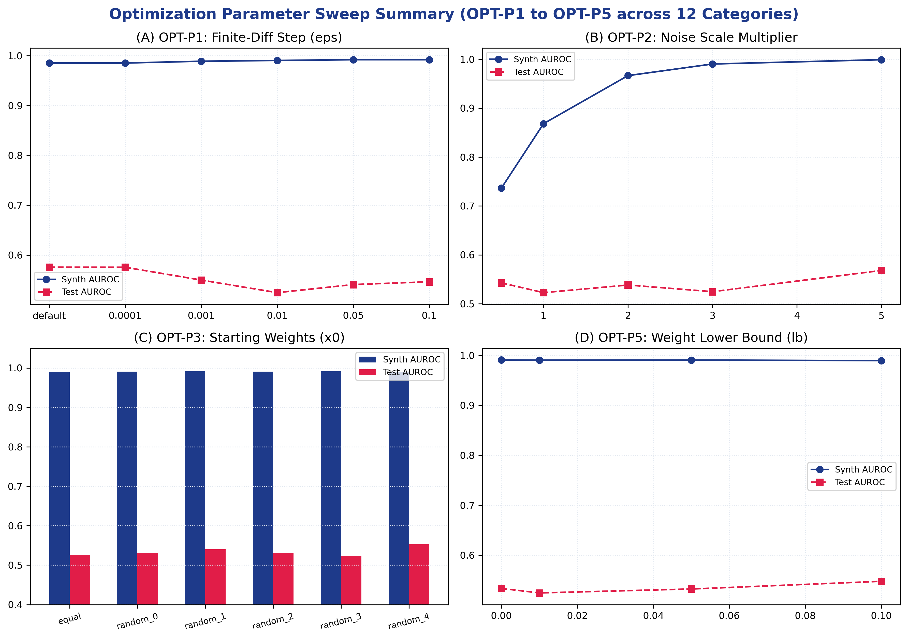

# Consolidated Model Comparison Report: DIP Optimization

## 1. Executive Summary
Investigation of numerical optimization methods (SLSQP, CG, L-BFGS-B, trust-constr) using `scipy.optimize` across all 12 categories.

| experiment_id   |   image_auroc |   f1_score |   training_time_s |
|:----------------|--------------:|-----------:|------------------:|
| OPT-BFGS        |        0.5746 |     0.2185 |            0.0457 |
| OPT-CG          |        0.5746 |     0.2185 |            0.0446 |
| OPT-SLSQP       |        0.5746 |     0.2185 |            0.0453 |
| OPT-TRUST       |        0.5746 |     0.2185 |            0.4684 |

## 2. Key Negative Finding
While optimizers achieved >0.98 AUROC on synthetic pseudo-anomalies, test generalization remained at 0.5758 AUROC (identical to equal baseline weights), demonstrating that additive Gaussian feature perturbation fails to model real morphological defect distributions.

## 3. Parameter Sensitivity Sweep (OPT-P1 to OPT-P5 across 444 trials)

| experiment_id   | method   | param   | value   |   synth_auroc |   test_auroc |   moved_L1 |   n_iter |
|:----------------|:---------|:--------|:--------|--------------:|-------------:|-----------:|---------:|
| OPT-P1          | SLSQP    | eps     | default |        0.9853 |       0.5758 |     0      |   1      |
| OPT-P1          | SLSQP    | eps     | 0.0001  |        0.9853 |       0.5757 |     0.0004 |   1.0833 |
| OPT-P1          | SLSQP    | eps     | 0.001   |        0.9889 |       0.55   |     0.2369 |   3.1667 |
| OPT-P1          | SLSQP    | eps     | 0.01    |        0.9905 |       0.5247 |     0.4079 |   5.3333 |
| OPT-P1          | SLSQP    | eps     | 0.05    |        0.992  |       0.541  |     0.5    |   5.25   |
| OPT-P1          | SLSQP    | eps     | 0.1     |        0.992  |       0.5466 |     0.4973 |   5.5    |
| OPT-P1          | CG       | eps     | default |        0.9853 |       0.5758 |     0      |   0      |
| OPT-P1          | CG       | eps     | 0.0001  |        0.9861 |       0.573  |     0.0637 |   0.25   |
| OPT-P1          | CG       | eps     | 0.001   |        0.9882 |       0.5489 |     0.2751 |   2.3333 |
| OPT-P1          | CG       | eps     | 0.01    |        0.9904 |       0.5259 |     0.4338 |   3.75   |
| OPT-P1          | CG       | eps     | 0.05    |        0.9915 |       0.5446 |     0.4882 |   2.0833 |
| OPT-P1          | CG       | eps     | 0.1     |        0.9905 |       0.5432 |     0.475  |   1.3333 |
| OPT-P1          | L-BFGS-B | eps     | default |        0.9853 |       0.5758 |     0      |   0      |
| OPT-P1          | L-BFGS-B | eps     | 0.0001  |        0.9862 |       0.5678 |     0.1003 |   0.25   |
| OPT-P1          | L-BFGS-B | eps     | 0.001   |        0.9878 |       0.5536 |     0.3018 |   2      |
| OPT-P1          | L-BFGS-B | eps     | 0.01    |        0.9908 |       0.5356 |     0.4038 |   6      |
| OPT-P1          | L-BFGS-B | eps     | 0.05    |        0.992  |       0.5403 |     0.5414 |   4.4167 |
| OPT-P1          | L-BFGS-B | eps     | 0.1     |        0.9917 |       0.5353 |     0.5568 |   3.9167 |

*(Full sweep results across all 37 configurations available in `param_sweep/PARAM_SWEEP_REPORT.md`)*

