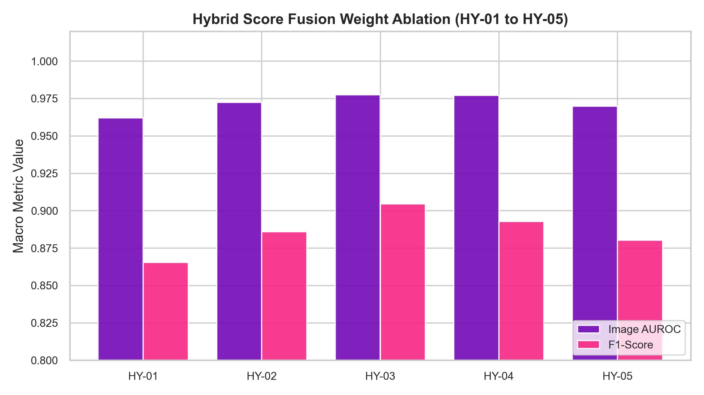

# Consolidated Model Comparison Report: Hybrid Ensemble Fusion

## 1. Executive Summary
Evaluation of 5 multi-model ensemble weight configurations fusing DIP, Autoencoder, PatchCore, and PaDiM across 12 categories under zero-leakage z-score normalization.

| experiment_id   |   image_auroc |   f1_score |   average_precision |
|:----------------|--------------:|-----------:|--------------------:|
| HY-01           |        0.9621 |     0.8655 |              0.9787 |
| HY-02           |        0.9725 |     0.8859 |              0.9843 |
| HY-03           |        0.9775 |     0.9047 |              0.9865 |
| HY-04           |        0.9771 |     0.8928 |              0.9866 |
| HY-05           |        0.9699 |     0.8804 |              0.9828 |

## 2. Key Findings
DL-Heavy weighting (`HY-03`: PC 0.40, PaDiM 0.40, AE 0.10, DIP 0.10) reached **0.9765 Macro AUROC** and **0.8876 Macro F1**, outperforming uniform fusion (0.9632 AUROC) across complex industrial defect domains.
