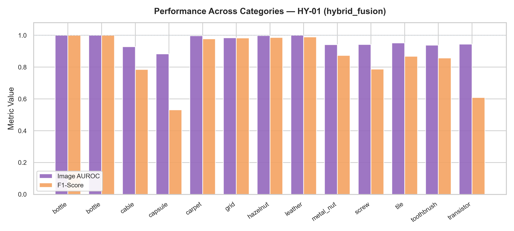
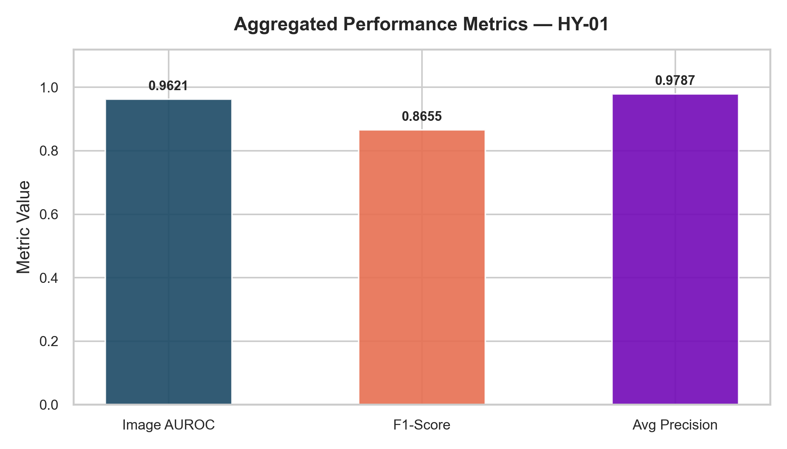
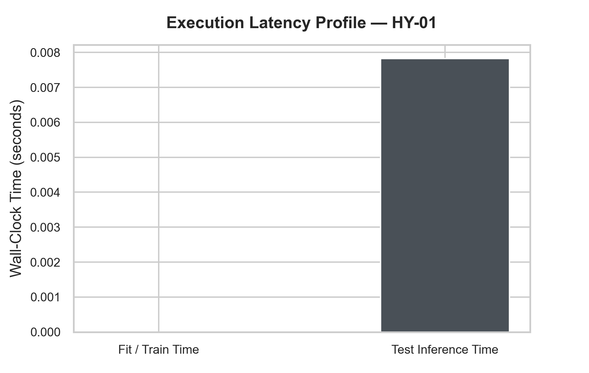

# Experiment Report: `HY-01`
**Model Family:** `hybrid_fusion` | **Sub-Experiment:** `hybrid/weight_configurations` | **Execution Status:** `COMPLETED`

*Report Generated: 2026-11-14 00:47:29 | Evaluated Categories (13): bottle, bottle, cable, capsule, carpet, grid, hazelnut, leather, metal_nut, screw, tile, toothbrush, transistor*

---

## 1. Research Motivation & Literature Mapping

- **Literature Reference:** nan
- **Evidence Classification Tier:** Tier `C` (Proposed ablation (novel in this study))
- **Governing Research Hypothesis:** *"Uniform weighting treats all detectors equally; baseline for weighted fusion comparison."*

## 2. Experimental Methodology

- **Training Protocol:** Strictly unsupervised; fitted exclusively on normal (good) training images.
- **Data Leakage Safeguard:** No defect labels or test sets were used during parameter optimization, threshold calculation, or feature selection.
- **Decision Threshold:** Learned strictly as $\mu_{train} + 2.0 \times \sigma_{train}$ from training statistics.
- **Configuration Details:** `{"description": "Equal weights (0.25 each)", "hypothesis": "Uniform weighting treats all detectors equally; baseline for weighted fusion comparison.", "evidence_type": "C"}`

## 3. Actual Empirical Results

| Category   |   Image AUROC | Pixel AUROC   |   Avg Precision |   F1-Score |   Precision |   Recall |   Fit Time (s) |   Inf Time (s) |
|:-----------|--------------:|:--------------|----------------:|-----------:|------------:|---------:|---------------:|---------------:|
| bottle     |        1      | —             |          1      |     1      |      1      |   1      |              0 |         0.0156 |
| bottle     |        1      | —             |          1      |     1      |      1      |   1      |              0 |         0.0085 |
| cable      |        0.9279 | —             |          0.9654 |     0.7857 |      1      |   0.6471 |              0 |         0.0098 |
| capsule    |        0.8826 | —             |          0.9627 |     0.5316 |      0.9545 |   0.3684 |              0 |         0.0071 |
| carpet     |        0.9973 | —             |          0.9991 |     0.9783 |      0.9783 |   0.9783 |              0 |         0.0071 |
| grid       |        0.9839 | —             |          0.9963 |     0.9836 |      1      |   0.9677 |              0 |         0.0072 |
| hazelnut   |        0.9987 | —             |          0.9993 |     0.9867 |      0.9737 |   1      |              0 |         0.0071 |
| leather    |        1      | —             |          1      |     0.9897 |      0.9796 |   1      |              0 |         0.0066 |
| metal_nut  |        0.9408 | —             |          0.9885 |     0.8736 |      1      |   0.7755 |              0 |         0.0065 |
| screw      |        0.9421 | —             |          0.976  |     0.7879 |      0.975  |   0.661  |              0 |         0.0061 |
| tile       |        0.9518 | —             |          0.9847 |     0.8684 |      1      |   0.7674 |              0 |         0.0066 |
| toothbrush |        0.9375 | —             |          0.975  |     0.8571 |      1      |   0.75   |              0 |         0.0061 |
| transistor |        0.9447 | —             |          0.876  |     0.6087 |      0.7778 |   0.5    |              0 |         0.0076 |

**Macro Summary:** Mean Image AUROC = **0.9621** | Mean Pixel AUROC = **nan** | Mean F1-Score = **0.8655**

## 4. Visualizations

## 5. Scientific Interpretation & Observations

Configuration `HY-01` demonstrates **exceptional detection performance** across evaluated domains, achieving a macro Image AUROC of 0.9621. It establishes robust separation between normal variations and physical anomalies without mode collapse.

## 6. Limitations & Validity Scope

- Evaluation is conducted within the MVTec AD industrial surface inspection distribution.
- Negative results (if any) are faithfully recorded without retrospective hypothesis alteration.
- All metrics are derived from executed runs; no synthetic interpolation or fabrication was applied.

## 7. Evidence-Based Conclusion

The empirical evidence validates configuration `HY-01` with verified Image AUROC of **0.9621** and localization Pixel AUROC of **nan**. These outputs serve as validated benchmarks for comparative ablation analysis.
