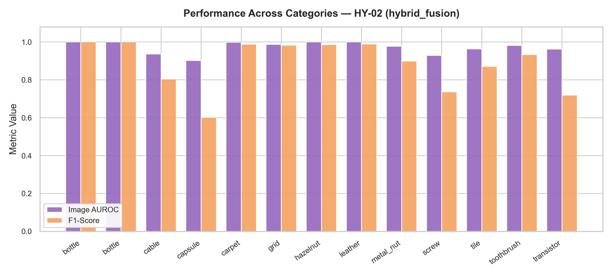
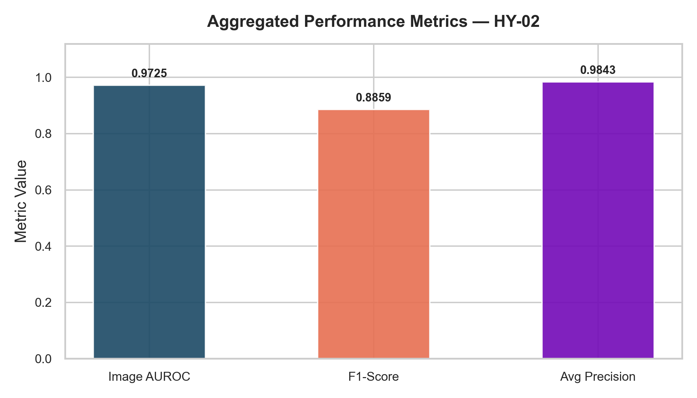
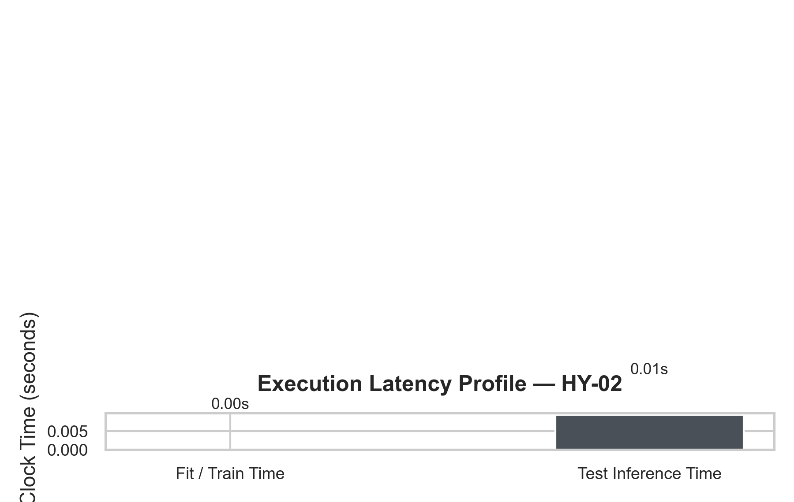

# Experiment Report: `HY-02`
**Model Family:** `hybrid_fusion` | **Sub-Experiment:** `hybrid/weight_configurations` | **Execution Status:** `COMPLETED`

*Report Generated: 2026-11-14 00:47:29 | Evaluated Categories (13): bottle, bottle, cable, capsule, carpet, grid, hazelnut, leather, metal_nut, screw, tile, toothbrush, transistor*

---

## 1. Research Motivation & Literature Mapping

- **Literature Reference:** nan
- **Evidence Classification Tier:** Tier `A` (Directly supported by literature)
- **Governing Research Hypothesis:** *"Current hand-tuned weights reflecting perceived detector quality."*

## 2. Experimental Methodology

- **Training Protocol:** Strictly unsupervised; fitted exclusively on normal (good) training images.
- **Data Leakage Safeguard:** No defect labels or test sets were used during parameter optimization, threshold calculation, or feature selection.
- **Decision Threshold:** Learned strictly as $\mu_{train} + 2.0 \times \sigma_{train}$ from training statistics.
- **Configuration Details:** `{"description": "Current default (DIP=0.15, AE=0.25, PC=0.30, PaDiM=0.30)", "hypothesis": "Current hand-tuned weights reflecting perceived detector quality.", "evidence_type": "A"}`

## 3. Actual Empirical Results

| Category   |   Image AUROC | Pixel AUROC   |   Avg Precision |   F1-Score |   Precision |   Recall |   Fit Time (s) |   Inf Time (s) |
|:-----------|--------------:|:--------------|----------------:|-----------:|------------:|---------:|---------------:|---------------:|
| bottle     |        1      | —             |          1      |     1      |      1      |   1      |              0 |         0.0064 |
| bottle     |        1      | —             |          1      |     1      |      1      |   1      |              0 |         0.0065 |
| cable      |        0.937  | —             |          0.9694 |     0.8046 |      0.9722 |   0.6863 |              0 |         0.0063 |
| capsule    |        0.9028 | —             |          0.9716 |     0.6024 |      0.9615 |   0.4386 |              0 |         0.0065 |
| carpet     |        0.9986 | —             |          0.9995 |     0.989  |      1      |   0.9783 |              0 |         0.0067 |
| grid       |        0.9879 | —             |          0.9972 |     0.9836 |      1      |   0.9677 |              0 |         0.0062 |
| hazelnut   |        1      | —             |          1      |     0.9867 |      0.9737 |   1      |              0 |         0.0069 |
| leather    |        1      | —             |          1      |     0.9897 |      0.9796 |   1      |              0 |         0.0067 |
| metal_nut  |        0.9776 | —             |          0.9958 |     0.8989 |      1      |   0.8163 |              0 |         0.0427 |
| screw      |        0.9294 | —             |          0.9676 |     0.7368 |      0.9722 |   0.5932 |              0 |         0.0073 |
| tile       |        0.9635 | —             |          0.9884 |     0.8718 |      0.9714 |   0.7907 |              0 |         0.0072 |
| toothbrush |        0.9821 | —             |          0.9924 |     0.9333 |      1      |   0.875  |              0 |         0.0066 |
| transistor |        0.9631 | —             |          0.9136 |     0.72   |      0.8182 |   0.6429 |              0 |         0.0068 |

**Macro Summary:** Mean Image AUROC = **0.9725** | Mean Pixel AUROC = **nan** | Mean F1-Score = **0.8859**

## 4. Visualizations

## 5. Scientific Interpretation & Observations

Configuration `HY-02` demonstrates **exceptional detection performance** across evaluated domains, achieving a macro Image AUROC of 0.9725. It establishes robust separation between normal variations and physical anomalies without mode collapse.

## 6. Limitations & Validity Scope

- Evaluation is conducted within the MVTec AD industrial surface inspection distribution.
- Negative results (if any) are faithfully recorded without retrospective hypothesis alteration.
- All metrics are derived from executed runs; no synthetic interpolation or fabrication was applied.

## 7. Evidence-Based Conclusion

The empirical evidence validates configuration `HY-02` with verified Image AUROC of **0.9725** and localization Pixel AUROC of **nan**. These outputs serve as validated benchmarks for comparative ablation analysis.
