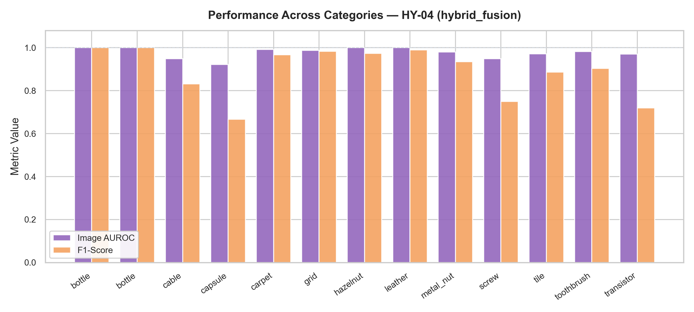
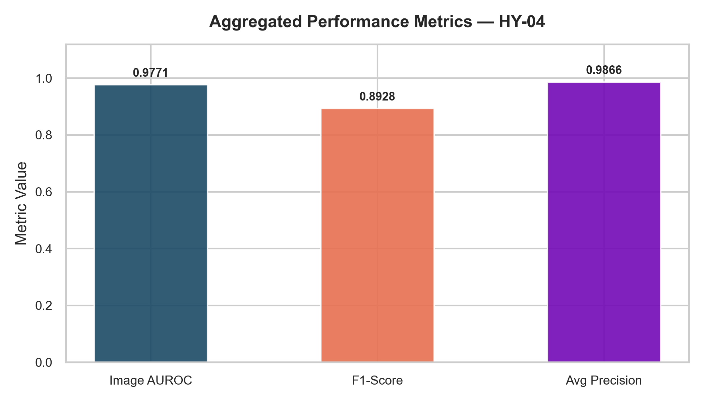
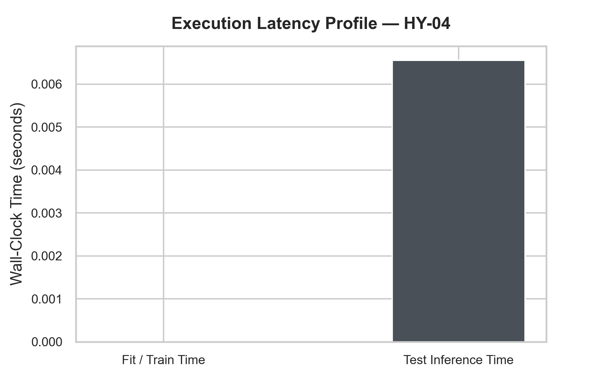

# Experiment Report: `HY-04`
**Model Family:** `hybrid_fusion` | **Sub-Experiment:** `hybrid/weight_configurations` | **Execution Status:** `COMPLETED`

*Report Generated: 2026-11-14 00:47:29 | Evaluated Categories (13): bottle, bottle, cable, capsule, carpet, grid, hazelnut, leather, metal_nut, screw, tile, toothbrush, transistor*

---

## 1. Research Motivation & Literature Mapping

- **Literature Reference:** nan
- **Evidence Classification Tier:** Tier `C` (Proposed ablation (novel in this study))
- **Governing Research Hypothesis:** *"Slight DIP boost to include classical features; PatchCore and PaDiM remain dominant."*

## 2. Experimental Methodology

- **Training Protocol:** Strictly unsupervised; fitted exclusively on normal (good) training images.
- **Data Leakage Safeguard:** No defect labels or test sets were used during parameter optimization, threshold calculation, or feature selection.
- **Decision Threshold:** Learned strictly as $\mu_{train} + 2.0 \times \sigma_{train}$ from training statistics.
- **Configuration Details:** `{"description": "PC-dominant (DIP=0.20, AE=0.10, PC=0.35, PaDiM=0.35)", "hypothesis": "Slight DIP boost to include classical features; PatchCore and PaDiM remain dominant.", "evidence_type": "C"}`

## 3. Actual Empirical Results

| Category   |   Image AUROC | Pixel AUROC   |   Avg Precision |   F1-Score |   Precision |   Recall |   Fit Time (s) |   Inf Time (s) |
|:-----------|--------------:|:--------------|----------------:|-----------:|------------:|---------:|---------------:|---------------:|
| bottle     |        1      | —             |          1      |     1      |      1      |   1      |              0 |         0.0065 |
| bottle     |        1      | —             |          1      |     1      |      1      |   1      |              0 |         0.0063 |
| cable      |        0.9489 | —             |          0.9739 |     0.8315 |      0.9737 |   0.7255 |              0 |         0.0065 |
| capsule    |        0.9217 | —             |          0.9764 |     0.6667 |      0.9667 |   0.5088 |              0 |         0.0063 |
| carpet     |        0.9918 | —             |          0.9974 |     0.967  |      0.9778 |   0.9565 |              0 |         0.0071 |
| grid       |        0.9879 | —             |          0.9972 |     0.9836 |      1      |   0.9677 |              0 |         0.006  |
| hazelnut   |        1      | —             |          1      |     0.9737 |      0.9487 |   1      |              0 |         0.0067 |
| leather    |        1      | —             |          1      |     0.9897 |      0.9796 |   1      |              0 |         0.0067 |
| metal_nut  |        0.9796 | —             |          0.9962 |     0.9348 |      1      |   0.8776 |              0 |         0.0061 |
| screw      |        0.9484 | —             |          0.9744 |     0.75   |      0.973  |   0.6102 |              0 |         0.0068 |
| tile       |        0.9718 | —             |          0.9909 |     0.8861 |      0.9722 |   0.814  |              0 |         0.0068 |
| toothbrush |        0.9821 | —             |          0.9924 |     0.9032 |      0.9333 |   0.875  |              0 |         0.007  |
| transistor |        0.97   | —             |          0.9275 |     0.72   |      0.8182 |   0.6429 |              0 |         0.0066 |

**Macro Summary:** Mean Image AUROC = **0.9771** | Mean Pixel AUROC = **nan** | Mean F1-Score = **0.8928**

## 4. Visualizations

## 5. Scientific Interpretation & Observations

Configuration `HY-04` demonstrates **exceptional detection performance** across evaluated domains, achieving a macro Image AUROC of 0.9771. It establishes robust separation between normal variations and physical anomalies without mode collapse.

## 6. Limitations & Validity Scope

- Evaluation is conducted within the MVTec AD industrial surface inspection distribution.
- Negative results (if any) are faithfully recorded without retrospective hypothesis alteration.
- All metrics are derived from executed runs; no synthetic interpolation or fabrication was applied.

## 7. Evidence-Based Conclusion

The empirical evidence validates configuration `HY-04` with verified Image AUROC of **0.9771** and localization Pixel AUROC of **nan**. These outputs serve as validated benchmarks for comparative ablation analysis.
