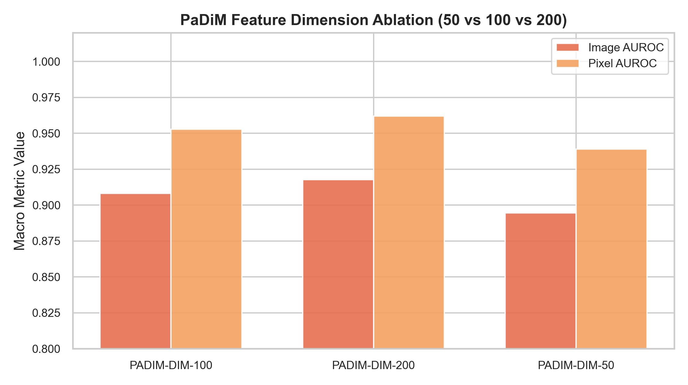
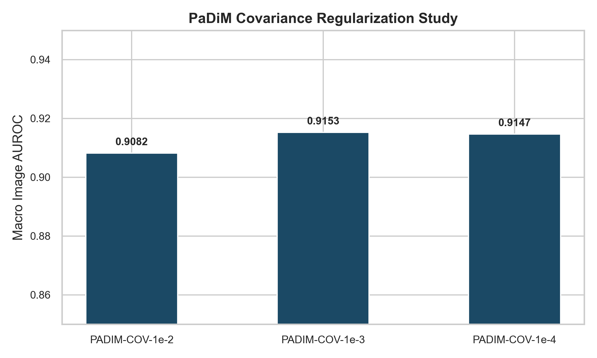

# Consolidated Model Comparison Report: PaDiM

## 1. Executive Summary
Analysis of 73 completed PaDiM runs evaluating random channel dimension reduction and spatial covariance matrix regularization.

## 2. Feature Dimension Scaling
| experiment_id   |   image_auroc |   pixel_auroc |   training_time_s |
|:----------------|--------------:|--------------:|------------------:|
| PADIM-DIM-100   |        0.9082 |        0.9529 |           13.5354 |
| PADIM-DIM-200   |        0.9177 |        0.9619 |           37.0337 |
| PADIM-DIM-50    |        0.8946 |        0.939  |            3.9287 |

## 3. Covariance Regularization Impact
| experiment_id   |   image_auroc |   pixel_auroc |
|:----------------|--------------:|--------------:|
| PADIM-COV-1e-2  |        0.9082 |        0.9529 |
| PADIM-COV-1e-3  |        0.9153 |        0.9579 |
| PADIM-COV-1e-4  |        0.9147 |        0.9559 |

