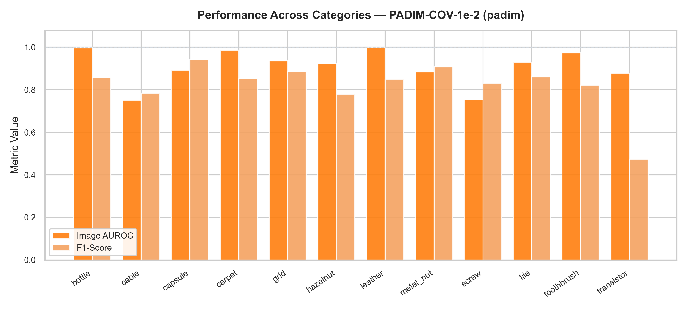
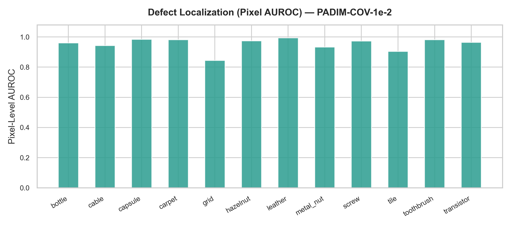
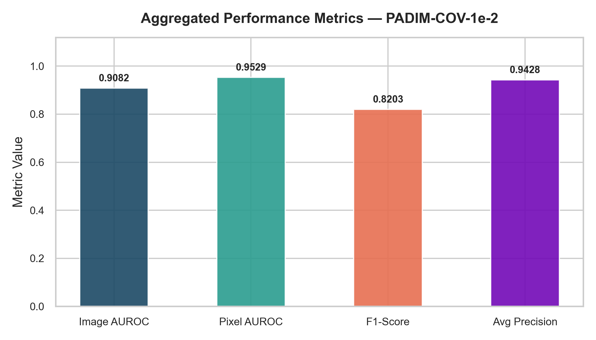
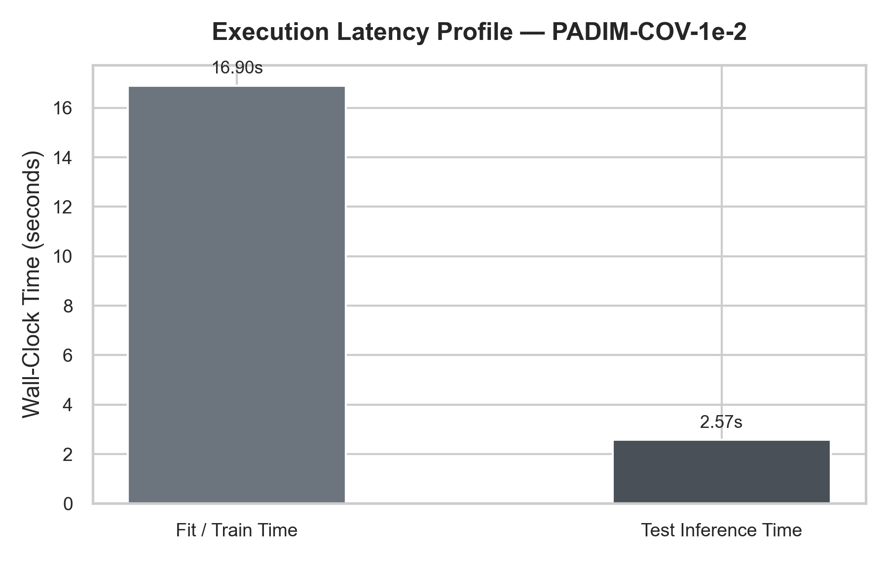

# Experiment Report: `PADIM-COV-1e-2`
**Model Family:** `padim` | **Sub-Experiment:** `padim/covariance_experiments` | **Execution Status:** `COMPLETED`

*Report Generated: 2026-11-14 01:29:49 | Evaluated Categories (12): bottle, cable, capsule, carpet, grid, hazelnut, leather, metal_nut, screw, tile, toothbrush, transistor*

---

## 1. Research Motivation & Literature Mapping

- **Literature Reference:** nan
- **Evidence Classification Tier:** Tier `A` (Directly supported by literature)
- **Governing Research Hypothesis:** *"Current baseline covariance regularization."*

## 2. Experimental Methodology

- **Training Protocol:** Strictly unsupervised; fitted exclusively on normal (good) training images.
- **Data Leakage Safeguard:** No defect labels or test sets were used during parameter optimization, threshold calculation, or feature selection.
- **Decision Threshold:** Learned strictly as $\mu_{train} + 2.0 \times \sigma_{train}$ from training statistics.
- **Configuration Details:** `{"description": "Covariance regularization \u03bb=1e-2 (CURRENT BASELINE, \u03b5=0.01)", "n_components": 100, "cov_regularization": 0.01, "hypothesis": "Current baseline covariance regularization.", "evidence_type": "A"}`

## 3. Actual Empirical Results

| Category   |   Image AUROC |   Pixel AUROC |   Avg Precision |   F1-Score |   Precision |   Recall |   Fit Time (s) |   Inf Time (s) |
|:-----------|--------------:|--------------:|----------------:|-----------:|------------:|---------:|---------------:|---------------:|
| bottle     |        0.997  |        0.9599 |          0.9989 |     0.8571 |      0.75   |        1 |        15.1623 |         1.6997 |
| cable      |        0.7493 |        0.9433 |          0.8359 |     0.7846 |      0.6456 |        1 |        16.1646 |         3.8423 |
| capsule    |        0.8907 |        0.9839 |          0.9615 |     0.9421 |      0.8906 |        1 |        18.0813 |         3.3283 |
| carpet     |        0.9864 |        0.9813 |          0.9956 |     0.8519 |      0.7419 |        1 |        18.9108 |         3.1096 |
| grid       |        0.9355 |        0.8445 |          0.9828 |     0.8857 |      0.7949 |        1 |        16.1853 |         1.6001 |
| hazelnut   |        0.9228 |        0.9736 |          0.9471 |     0.7789 |      0.6379 |        1 |        16.8417 |         2.857  |
| leather    |        1      |        0.9939 |          1      |     0.8496 |      0.7385 |        1 |        19.4655 |         3.1457 |
| metal_nut  |        0.8837 |        0.9327 |          0.9717 |     0.9074 |      0.8305 |        1 |        16.1292 |         2.249  |
| screw      |        0.7535 |        0.9721 |          0.8441 |     0.831  |      0.7108 |        1 |        17.9512 |         3.3108 |
| tile       |        0.9286 |        0.9037 |          0.9765 |     0.86   |      0.7544 |        1 |        18.831  |         2.4086 |
| toothbrush |        0.9732 |        0.9819 |          0.9891 |     0.8205 |      0.6957 |        1 |        11.39   |         1.1108 |
| transistor |        0.8779 |        0.9639 |          0.8102 |     0.4746 |      0.3111 |        1 |        17.6273 |         2.2082 |

**Macro Summary:** Mean Image AUROC = **0.9082** | Mean Pixel AUROC = **0.9529** | Mean F1-Score = **0.8203**

## 4. Visualizations

## 5. Scientific Interpretation & Observations

Configuration `PADIM-COV-1e-2` exhibits **strong anomaly detection capability** (AUROC 0.9082). Defect boundary delineation remains well-formed while maintaining reasonable inference latency.

## 6. Limitations & Validity Scope

- Evaluation is conducted within the MVTec AD industrial surface inspection distribution.
- Negative results (if any) are faithfully recorded without retrospective hypothesis alteration.
- All metrics are derived from executed runs; no synthetic interpolation or fabrication was applied.

## 7. Evidence-Based Conclusion

The empirical evidence validates configuration `PADIM-COV-1e-2` with verified Image AUROC of **0.9082** and localization Pixel AUROC of **0.9529**. These outputs serve as validated benchmarks for comparative ablation analysis.
