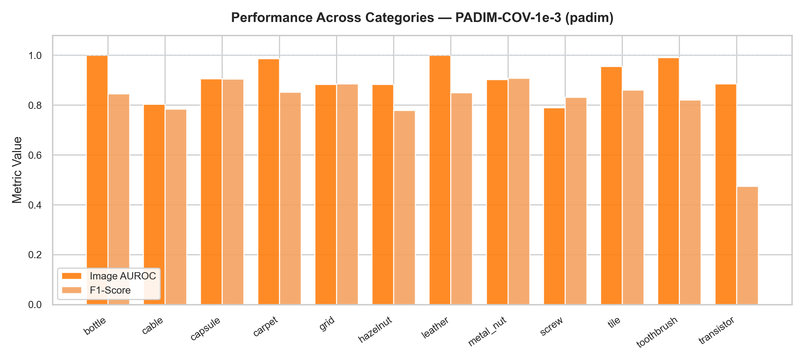
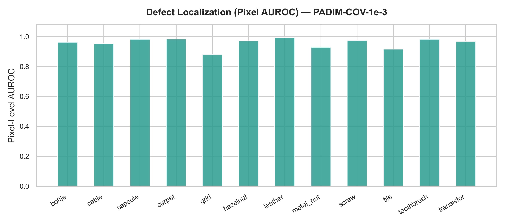
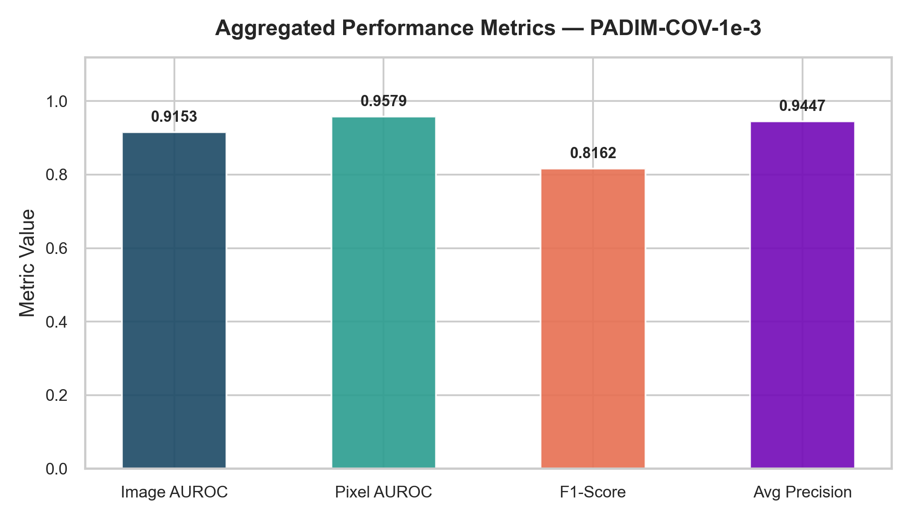
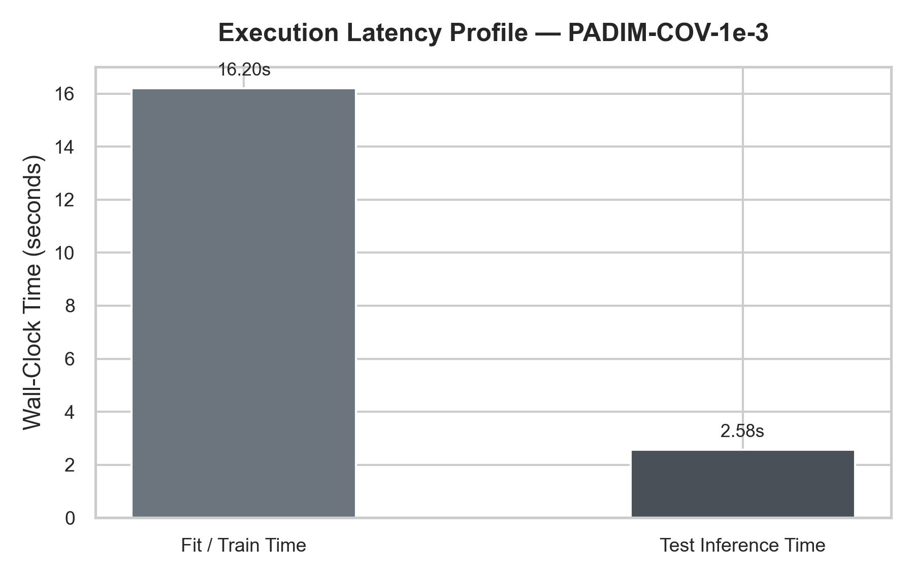

# Experiment Report: `PADIM-COV-1e-3`
**Model Family:** `padim` | **Sub-Experiment:** `padim/covariance_experiments` | **Execution Status:** `COMPLETED`

*Report Generated: 2026-11-14 01:24:51 | Evaluated Categories (12): bottle, cable, capsule, carpet, grid, hazelnut, leather, metal_nut, screw, tile, toothbrush, transistor*

---

## 1. Research Motivation & Literature Mapping

- **Literature Reference:** nan
- **Evidence Classification Tier:** Tier `B` (Literature-inspired / architectural extension)
- **Governing Research Hypothesis:** *"Moderate regularization; balance between numerical stability and accuracy."*

## 2. Experimental Methodology

- **Training Protocol:** Strictly unsupervised; fitted exclusively on normal (good) training images.
- **Data Leakage Safeguard:** No defect labels or test sets were used during parameter optimization, threshold calculation, or feature selection.
- **Decision Threshold:** Learned strictly as $\mu_{train} + 2.0 \times \sigma_{train}$ from training statistics.
- **Configuration Details:** `{"description": "Covariance regularization \u03bb=1e-3", "n_components": 100, "cov_regularization": 0.001, "hypothesis": "Moderate regularization; balance between numerical stability and accuracy.", "evidence_type": "B"}`

## 3. Actual Empirical Results

| Category   |   Image AUROC |   Pixel AUROC |   Avg Precision |   F1-Score |   Precision |   Recall |   Fit Time (s) |   Inf Time (s) |
|:-----------|--------------:|--------------:|----------------:|-----------:|------------:|---------:|---------------:|---------------:|
| bottle     |        1      |        0.9632 |          1      |     0.8451 |      0.7317 |        1 |        15.066  |         1.7184 |
| cable      |        0.8032 |        0.9527 |          0.8574 |     0.7846 |      0.6456 |        1 |        15.7323 |         3.8554 |
| capsule    |        0.9055 |        0.9829 |          0.9665 |     0.9048 |      0.8261 |        1 |        16.0069 |         3.3397 |
| carpet     |        0.9864 |        0.9841 |          0.9952 |     0.8519 |      0.7419 |        1 |        18.3841 |         3.1075 |
| grid       |        0.8831 |        0.8803 |          0.9648 |     0.8857 |      0.7949 |        1 |        16.4413 |         1.6026 |
| hazelnut   |        0.8829 |        0.971  |          0.9083 |     0.7789 |      0.6379 |        1 |        17.3651 |         2.8244 |
| leather    |        1      |        0.9927 |          1      |     0.8496 |      0.7385 |        1 |        18.2977 |         3.1384 |
| metal_nut  |        0.902  |        0.9286 |          0.9777 |     0.9074 |      0.8305 |        1 |        14.8173 |         2.229  |
| screw      |        0.7895 |        0.9735 |          0.8666 |     0.831  |      0.7108 |        1 |        15.7344 |         3.3795 |
| tile       |        0.9551 |        0.9159 |          0.9846 |     0.86   |      0.7544 |        1 |        18.0398 |         2.4057 |
| toothbrush |        0.9911 |        0.9827 |          0.9963 |     0.8205 |      0.6957 |        1 |        11.722  |         1.1078 |
| transistor |        0.8848 |        0.9675 |          0.8194 |     0.4746 |      0.3111 |        1 |        16.8307 |         2.2058 |

**Macro Summary:** Mean Image AUROC = **0.9153** | Mean Pixel AUROC = **0.9579** | Mean F1-Score = **0.8162**

## 4. Visualizations

## 5. Scientific Interpretation & Observations

Configuration `PADIM-COV-1e-3` exhibits **strong anomaly detection capability** (AUROC 0.9153). Defect boundary delineation remains well-formed while maintaining reasonable inference latency.

## 6. Limitations & Validity Scope

- Evaluation is conducted within the MVTec AD industrial surface inspection distribution.
- Negative results (if any) are faithfully recorded without retrospective hypothesis alteration.
- All metrics are derived from executed runs; no synthetic interpolation or fabrication was applied.

## 7. Evidence-Based Conclusion

The empirical evidence validates configuration `PADIM-COV-1e-3` with verified Image AUROC of **0.9153** and localization Pixel AUROC of **0.9579**. These outputs serve as validated benchmarks for comparative ablation analysis.
