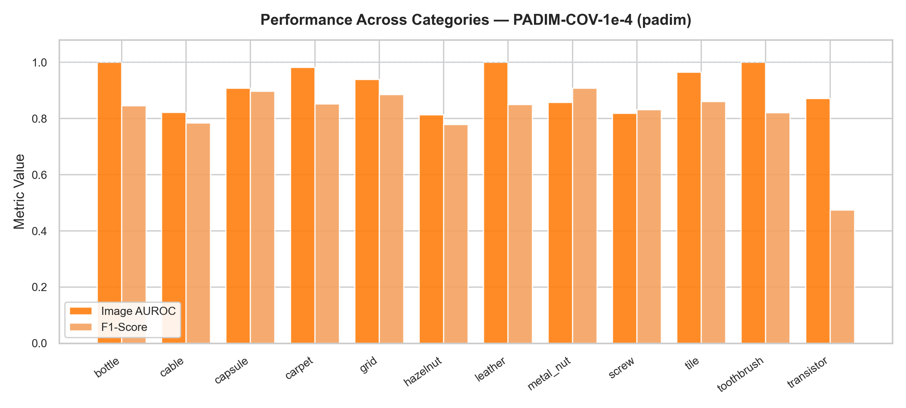
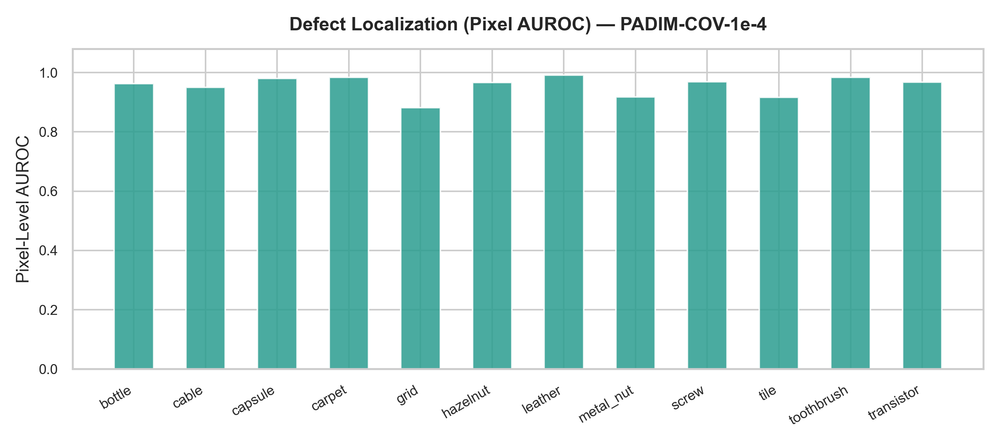
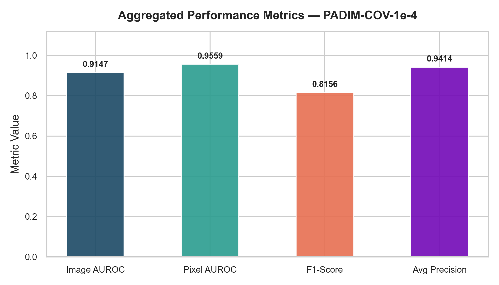
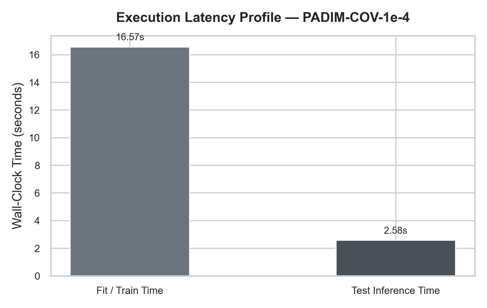

# Experiment Report: `PADIM-COV-1e-4`
**Model Family:** `padim` | **Sub-Experiment:** `padim/covariance_experiments` | **Execution Status:** `COMPLETED`

*Report Generated: 2026-11-14 01:19:50 | Evaluated Categories (12): bottle, cable, capsule, carpet, grid, hazelnut, leather, metal_nut, screw, tile, toothbrush, transistor*

---

## 1. Research Motivation & Literature Mapping

- **Literature Reference:** nan
- **Evidence Classification Tier:** Tier `C` (Proposed ablation (novel in this study))
- **Governing Research Hypothesis:** *"Very small regularization; covariance closer to empirical estimate; risk of singular matrices."*

## 2. Experimental Methodology

- **Training Protocol:** Strictly unsupervised; fitted exclusively on normal (good) training images.
- **Data Leakage Safeguard:** No defect labels or test sets were used during parameter optimization, threshold calculation, or feature selection.
- **Decision Threshold:** Learned strictly as $\mu_{train} + 2.0 \times \sigma_{train}$ from training statistics.
- **Configuration Details:** `{"description": "Covariance regularization \u03bb=1e-4", "n_components": 100, "cov_regularization": 0.0001, "hypothesis": "Very small regularization; covariance closer to empirical estimate; risk of singular matrices.", "evidence_type": "C"}`

## 3. Actual Empirical Results

| Category   |   Image AUROC |   Pixel AUROC |   Avg Precision |   F1-Score |   Precision |   Recall |   Fit Time (s) |   Inf Time (s) |
|:-----------|--------------:|--------------:|----------------:|-----------:|------------:|---------:|---------------:|---------------:|
| bottle     |        1      |        0.9628 |          1      |     0.8451 |      0.7317 |        1 |        16.3163 |         1.7337 |
| cable      |        0.8214 |        0.9501 |          0.8595 |     0.7846 |      0.6456 |        1 |        17.5906 |         3.8494 |
| capsule    |        0.9082 |        0.9807 |          0.9722 |     0.8976 |      0.8143 |        1 |        17.1674 |         3.3349 |
| carpet     |        0.9823 |        0.9839 |          0.994  |     0.8519 |      0.7419 |        1 |        18.7425 |         3.1098 |
| grid       |        0.9395 |        0.8815 |          0.9822 |     0.8857 |      0.7949 |        1 |        18.5572 |         1.5973 |
| hazelnut   |        0.8134 |        0.966  |          0.8471 |     0.7789 |      0.6379 |        1 |        17.0445 |         2.8542 |
| leather    |        1      |        0.9915 |          1      |     0.8496 |      0.7385 |        1 |        18.4155 |         3.1354 |
| metal_nut  |        0.8571 |        0.9183 |          0.9604 |     0.9074 |      0.8305 |        1 |        14.6366 |         2.2392 |
| screw      |        0.8185 |        0.9686 |          0.8963 |     0.831  |      0.7108 |        1 |        15.949  |         3.3323 |
| tile       |        0.9651 |        0.9167 |          0.9876 |     0.86   |      0.7544 |        1 |        17.0229 |         2.4868 |
| toothbrush |        1      |        0.9834 |          1      |     0.8205 |      0.6957 |        1 |        11.2974 |         1.1176 |
| transistor |        0.871  |        0.9672 |          0.7981 |     0.4746 |      0.3111 |        1 |        16.0446 |         2.213  |

**Macro Summary:** Mean Image AUROC = **0.9147** | Mean Pixel AUROC = **0.9559** | Mean F1-Score = **0.8156**

## 4. Visualizations

## 5. Scientific Interpretation & Observations

Configuration `PADIM-COV-1e-4` exhibits **strong anomaly detection capability** (AUROC 0.9147). Defect boundary delineation remains well-formed while maintaining reasonable inference latency.

## 6. Limitations & Validity Scope

- Evaluation is conducted within the MVTec AD industrial surface inspection distribution.
- Negative results (if any) are faithfully recorded without retrospective hypothesis alteration.
- All metrics are derived from executed runs; no synthetic interpolation or fabrication was applied.

## 7. Evidence-Based Conclusion

The empirical evidence validates configuration `PADIM-COV-1e-4` with verified Image AUROC of **0.9147** and localization Pixel AUROC of **0.9559**. These outputs serve as validated benchmarks for comparative ablation analysis.
