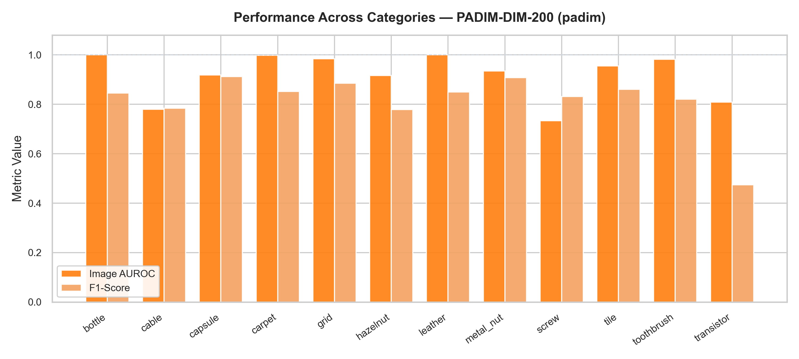
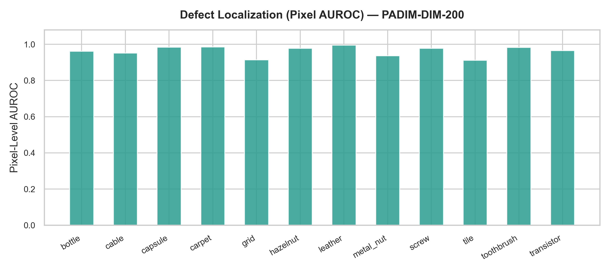
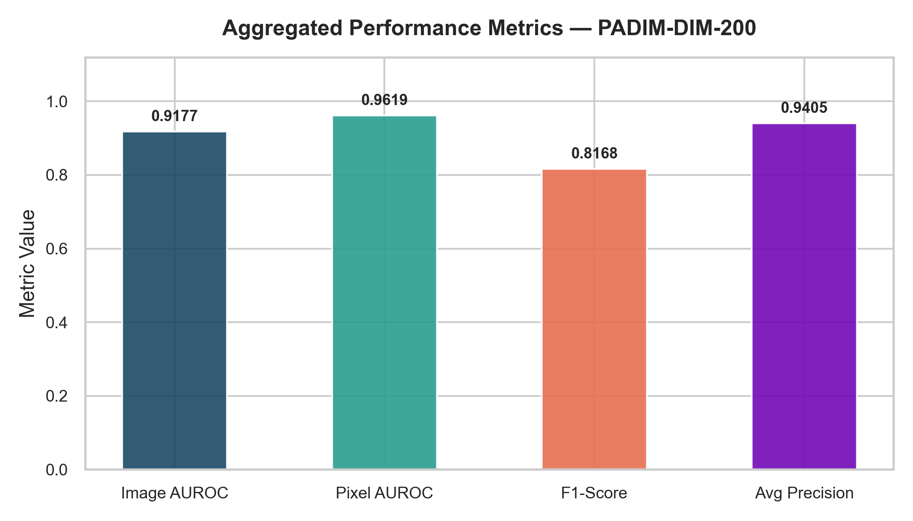
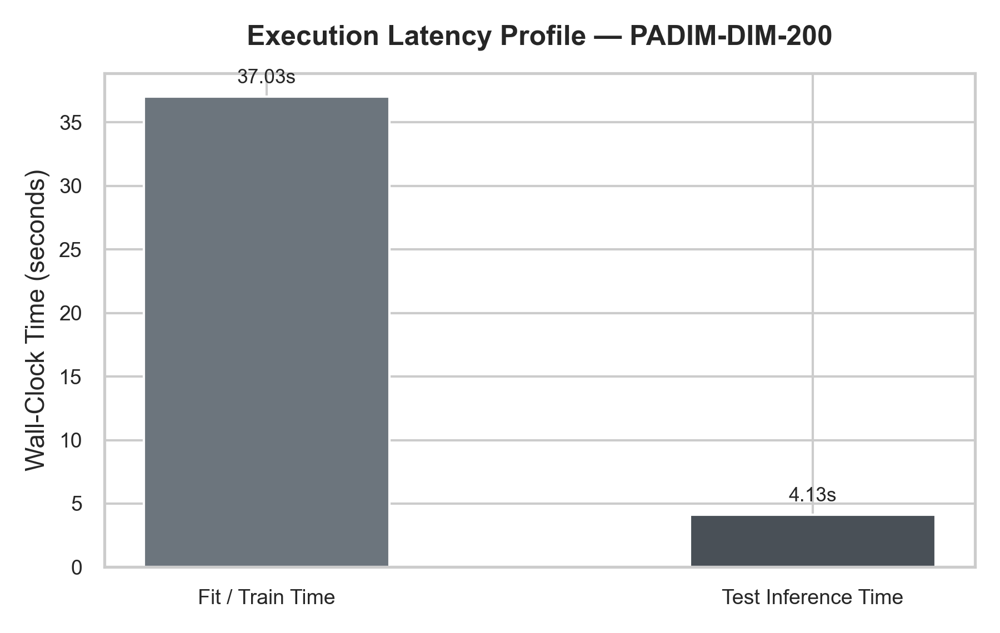

# Experiment Report: `PADIM-DIM-200`
**Model Family:** `padim` | **Sub-Experiment:** `padim/feature_dimension_experiments` | **Execution Status:** `COMPLETED`

*Report Generated: 2026-11-14 01:10:05 | Evaluated Categories (12): bottle, cable, capsule, carpet, grid, hazelnut, leather, metal_nut, screw, tile, toothbrush, transistor*

---

## 1. Research Motivation & Literature Mapping

- **Literature Reference:** Defard et al. (2021) Table 2 — 100 dims optimal for ResNet-18.
- **Evidence Classification Tier:** Tier `A` (Directly supported by literature)
- **Governing Research Hypothesis:** *"More channels capture richer covariance structure; may improve separation but increase computation."*

## 2. Experimental Methodology

- **Training Protocol:** Strictly unsupervised; fitted exclusively on normal (good) training images.
- **Data Leakage Safeguard:** No defect labels or test sets were used during parameter optimization, threshold calculation, or feature selection.
- **Decision Threshold:** Learned strictly as $\mu_{train} + 2.0 \times \sigma_{train}$ from training statistics.
- **Configuration Details:** `{"description": "200 random channel dimensions", "n_components": 200, "cov_regularization": 0.01, "hypothesis": "More channels capture richer covariance structure; may improve separation but increase computation.", "literature": "Defard et al. (2021) Table 2 \u2014 100 dims optimal for ResNet-18.", "evidence_type": "A"}`

## 3. Actual Empirical Results

| Category   |   Image AUROC |   Pixel AUROC |   Avg Precision |   F1-Score |   Precision |   Recall |   Fit Time (s) |   Inf Time (s) |
|:-----------|--------------:|--------------:|----------------:|-----------:|------------:|---------:|---------------:|---------------:|
| bottle     |        1      |        0.9613 |          1      |     0.8451 |      0.7317 |        1 |        33.8974 |         3.1926 |
| cable      |        0.7801 |        0.9516 |          0.8566 |     0.7846 |      0.6456 |        1 |        36.0633 |         7.1501 |
| capsule    |        0.919  |        0.9844 |          0.9746 |     0.912  |      0.8382 |        1 |        40.6115 |         5.1343 |
| carpet     |        0.9986 |        0.9857 |          0.9995 |     0.8519 |      0.7419 |        1 |        37.079  |         4.6474 |
| grid       |        0.9839 |        0.9138 |          0.9959 |     0.8857 |      0.7949 |        1 |        35.4363 |         2.5483 |
| hazelnut   |        0.9163 |        0.9772 |          0.9478 |     0.7789 |      0.6379 |        1 |        39.6022 |         4.3421 |
| leather    |        1      |        0.9946 |          1      |     0.8496 |      0.7385 |        1 |        38.6135 |         4.7717 |
| metal_nut  |        0.9347 |        0.9365 |          0.9864 |     0.9074 |      0.8305 |        1 |        36.1549 |         3.7043 |
| screw      |        0.7338 |        0.9773 |          0.8243 |     0.831  |      0.7108 |        1 |        37.9794 |         5.3072 |
| tile       |        0.9551 |        0.9116 |          0.9854 |     0.86   |      0.7544 |        1 |        38.0323 |         3.8484 |
| toothbrush |        0.9821 |        0.9828 |          0.9931 |     0.8205 |      0.6957 |        1 |        32.8229 |         1.687  |
| transistor |        0.8088 |        0.9658 |          0.7221 |     0.4746 |      0.3111 |        1 |        38.1115 |         3.255  |

**Macro Summary:** Mean Image AUROC = **0.9177** | Mean Pixel AUROC = **0.9619** | Mean F1-Score = **0.8168**

## 4. Visualizations

## 5. Scientific Interpretation & Observations

Configuration `PADIM-DIM-200` exhibits **strong anomaly detection capability** (AUROC 0.9177). Defect boundary delineation remains well-formed while maintaining reasonable inference latency.

## 6. Limitations & Validity Scope

- Evaluation is conducted within the MVTec AD industrial surface inspection distribution.
- Negative results (if any) are faithfully recorded without retrospective hypothesis alteration.
- All metrics are derived from executed runs; no synthetic interpolation or fabrication was applied.

## 7. Evidence-Based Conclusion

The empirical evidence validates configuration `PADIM-DIM-200` with verified Image AUROC of **0.9177** and localization Pixel AUROC of **0.9619**. These outputs serve as validated benchmarks for comparative ablation analysis.
