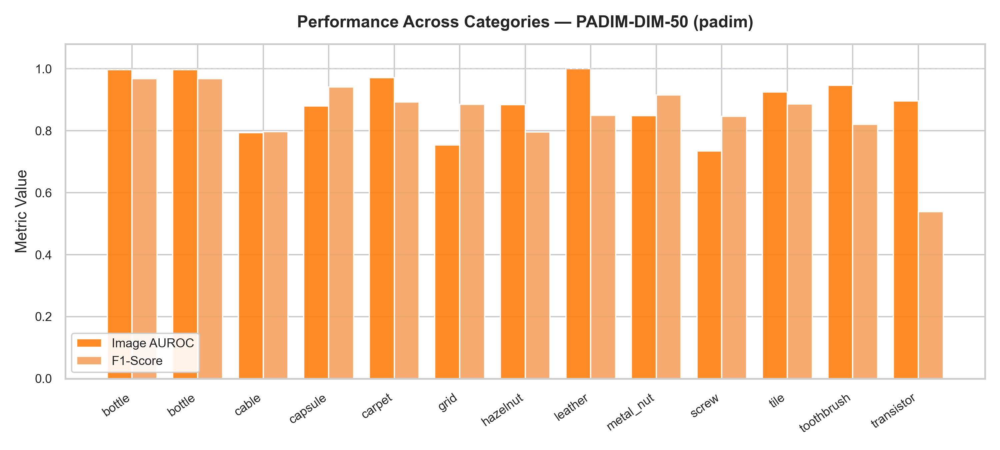
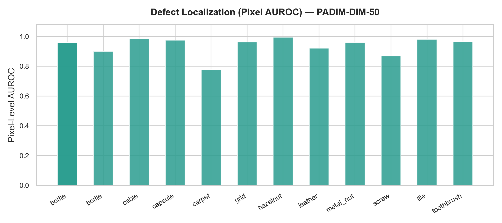
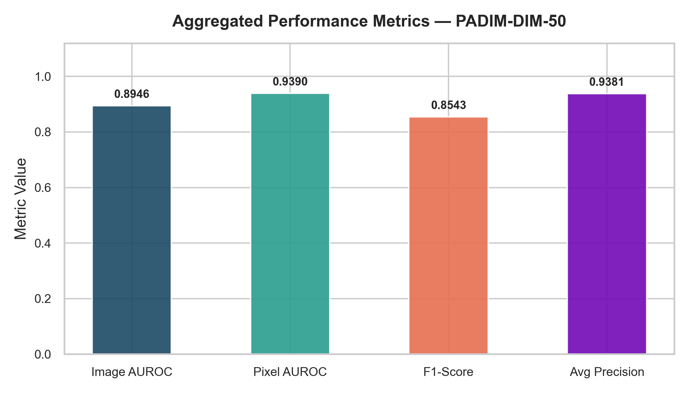
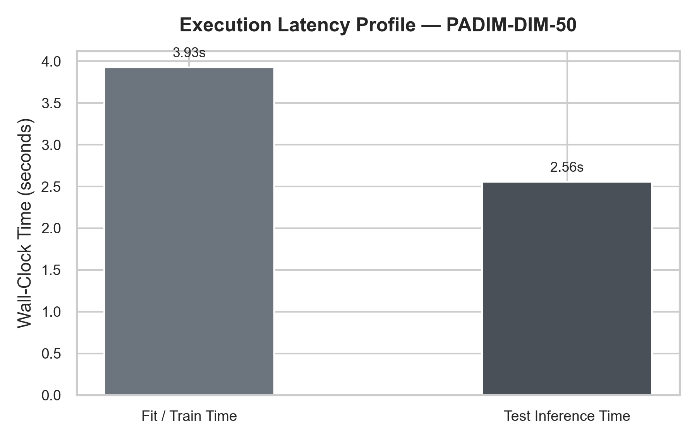

# Experiment Report: `PADIM-DIM-50`
**Model Family:** `padim` | **Sub-Experiment:** `padim/feature_dimension_experiments` | **Execution Status:** `COMPLETED`

*Report Generated: 2026-11-14 00:49:10 | Evaluated Categories (13): bottle, bottle, cable, capsule, carpet, grid, hazelnut, leather, metal_nut, screw, tile, toothbrush, transistor*

---

## 1. Research Motivation & Literature Mapping

- **Literature Reference:** Defard et al. (2021) PaDiM ablation on feature dimensions.
- **Evidence Classification Tier:** Tier `B` (Literature-inspired / architectural extension)
- **Governing Research Hypothesis:** *"Fewer channels = smaller covariance matrices; faster but potentially less expressive."*

## 2. Experimental Methodology

- **Training Protocol:** Strictly unsupervised; fitted exclusively on normal (good) training images.
- **Data Leakage Safeguard:** No defect labels or test sets were used during parameter optimization, threshold calculation, or feature selection.
- **Decision Threshold:** Learned strictly as $\mu_{train} + 2.0 \times \sigma_{train}$ from training statistics.
- **Configuration Details:** `{"description": "50 random channel dimensions", "n_components": 50, "cov_regularization": 0.01, "hypothesis": "Fewer channels = smaller covariance matrices; faster but potentially less expressive.", "evidence_type": "B", "literature": "Defard et al. (2021) PaDiM ablation on feature dimensions."}`

## 3. Actual Empirical Results

| Category   |   Image AUROC |   Pixel AUROC |   Avg Precision |   F1-Score |   Precision |   Recall |   Fit Time (s) |   Inf Time (s) |
|:-----------|--------------:|--------------:|----------------:|-----------:|------------:|---------:|---------------:|---------------:|
| bottle     |        0.997  |        0.9574 |          0.9989 |     0.9677 |      0.9375 |   1      |         3.1515 |         1.5373 |
| bottle     |        0.997  |        0.9574 |          0.9989 |     0.9677 |      0.9375 |   1      |         2.423  |         1.1926 |
| cable      |        0.7941 |        0.9004 |          0.867  |     0.7969 |      0.6623 |   1      |         3.8747 |         4.3114 |
| capsule    |        0.8799 |        0.9841 |          0.9531 |     0.9412 |      0.9032 |   0.9825 |         4.7169 |         3.6937 |
| carpet     |        0.9715 |        0.9755 |          0.9908 |     0.8932 |      0.807  |   1      |         5.5075 |         3.3522 |
| grid       |        0.754  |        0.7768 |          0.9127 |     0.8857 |      0.7949 |   1      |         4.4277 |         1.7235 |
| hazelnut   |        0.8842 |        0.9631 |          0.9004 |     0.7957 |      0.6607 |   1      |         5.3605 |         3.0825 |
| leather    |        1      |        0.9951 |          1      |     0.8496 |      0.7385 |   1      |         5.1527 |         3.4488 |
| metal_nut  |        0.849  |        0.9218 |          0.9621 |     0.9159 |      0.8448 |   1      |         3.6784 |         2.6748 |
| screw      |        0.7352 |        0.9595 |          0.8393 |     0.8467 |      0.7436 |   0.9831 |         3.5744 |         2.9336 |
| tile       |        0.9252 |        0.8697 |          0.9735 |     0.8866 |      0.7963 |   1      |         3.7241 |         2.1315 |
| toothbrush |        0.9464 |        0.9812 |          0.9776 |     0.8205 |      0.6957 |   1      |         1.3676 |         1.1897 |
| transistor |        0.8963 |        0.9649 |          0.8215 |     0.5385 |      0.3684 |   1      |         4.1137 |         1.9588 |

**Macro Summary:** Mean Image AUROC = **0.8946** | Mean Pixel AUROC = **0.9390** | Mean F1-Score = **0.8543**

## 4. Visualizations

## 5. Scientific Interpretation & Observations

Configuration `PADIM-DIM-50` exhibits **strong anomaly detection capability** (AUROC 0.8946). Defect boundary delineation remains well-formed while maintaining reasonable inference latency.

## 6. Limitations & Validity Scope

- Evaluation is conducted within the MVTec AD industrial surface inspection distribution.
- Negative results (if any) are faithfully recorded without retrospective hypothesis alteration.
- All metrics are derived from executed runs; no synthetic interpolation or fabrication was applied.

## 7. Evidence-Based Conclusion

The empirical evidence validates configuration `PADIM-DIM-50` with verified Image AUROC of **0.8946** and localization Pixel AUROC of **0.9390**. These outputs serve as validated benchmarks for comparative ablation analysis.
