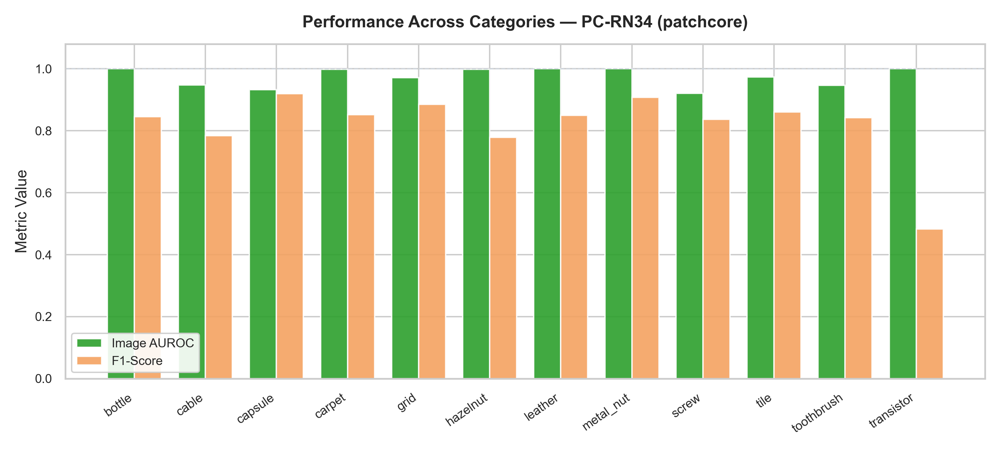
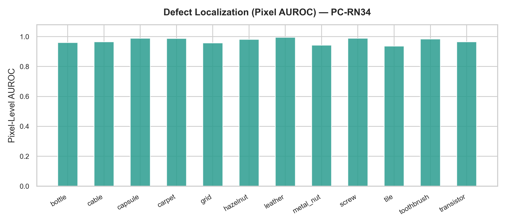
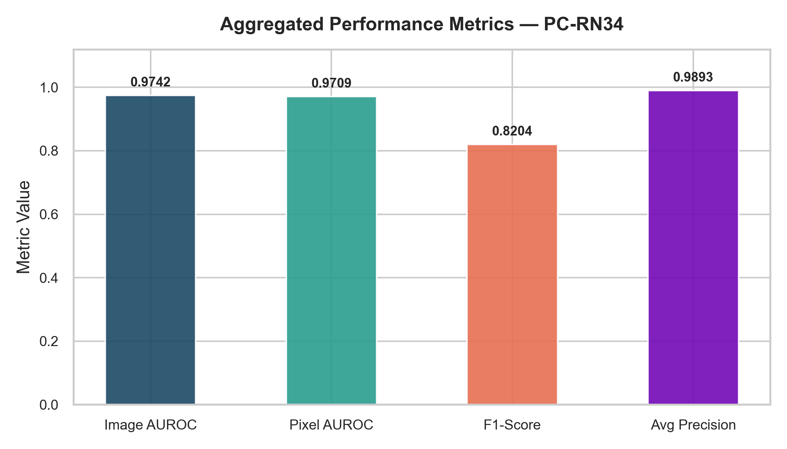
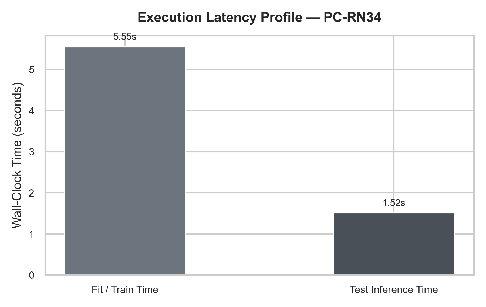

# Experiment Report: `PC-RN34`
**Model Family:** `patchcore` | **Sub-Experiment:** `patchcore/backbone_experiments` | **Execution Status:** `COMPLETED`

*Report Generated: 2026-11-14 01:47:13 | Evaluated Categories (12): bottle, cable, capsule, carpet, grid, hazelnut, leather, metal_nut, screw, tile, toothbrush, transistor*

---

## 1. Research Motivation & Literature Mapping

- **Literature Reference:** Roth et al. (2022) PatchCore backbone comparisons.
- **Evidence Classification Tier:** Tier `A` (Directly supported by literature)
- **Governing Research Hypothesis:** *"Deeper backbone provides richer feature representations; expected improved AUROC at higher VRAM cost."*

## 2. Experimental Methodology

- **Training Protocol:** Strictly unsupervised; fitted exclusively on normal (good) training images.
- **Data Leakage Safeguard:** No defect labels or test sets were used during parameter optimization, threshold calculation, or feature selection.
- **Decision Threshold:** Learned strictly as $\mu_{train} + 2.0 \times \sigma_{train}$ from training statistics.
- **Configuration Details:** `{"description": "ResNet-34 backbone", "backbone": "resnet34", "coreset_percentage": 0.05, "hypothesis": "Deeper backbone provides richer feature representations; expected improved AUROC at higher VRAM cost.", "literature": "Roth et al. (2022) PatchCore backbone comparisons.", "evidence_type": "A"}`

## 3. Actual Empirical Results

| Category   |   Image AUROC |   Pixel AUROC |   Avg Precision |   F1-Score |   Precision |   Recall |   Fit Time (s) |   Inf Time (s) |
|:-----------|--------------:|--------------:|----------------:|-----------:|------------:|---------:|---------------:|---------------:|
| bottle     |        1      |        0.9598 |          1      |     0.8451 |      0.7317 |        1 |         4.7534 |         0.8588 |
| cable      |        0.9482 |        0.9654 |          0.9733 |     0.7846 |      0.6456 |        1 |         5.8196 |         2.4691 |
| capsule    |        0.9325 |        0.9884 |          0.9775 |     0.9194 |      0.8507 |        1 |         5.7554 |         2.0658 |
| carpet     |        0.9986 |        0.9876 |          0.9995 |     0.8519 |      0.7419 |        1 |         7.3842 |         2.0488 |
| grid       |        0.9718 |        0.9571 |          0.9929 |     0.8857 |      0.7949 |        1 |         6.1883 |         0.7912 |
| hazelnut   |        0.9987 |        0.9809 |          0.9993 |     0.7789 |      0.6379 |        1 |         6.878  |         1.7932 |
| leather    |        1      |        0.9953 |          1      |     0.8496 |      0.7385 |        1 |         6.7283 |         2.2159 |
| metal_nut  |        1      |        0.9423 |          1      |     0.9074 |      0.8305 |        1 |         4.7111 |         0.9651 |
| screw      |        0.9209 |        0.9887 |          0.9642 |     0.8369 |      0.7195 |        1 |         5.8414 |         1.6385 |
| tile       |        0.9734 |        0.9367 |          0.9907 |     0.86   |      0.7544 |        1 |         5.6967 |         1.2959 |
| toothbrush |        0.9464 |        0.9841 |          0.9738 |     0.8421 |      0.7273 |        1 |         1.0424 |         0.6925 |
| transistor |        1      |        0.9649 |          1      |     0.4828 |      0.3182 |        1 |         5.8406 |         1.3587 |

**Macro Summary:** Mean Image AUROC = **0.9742** | Mean Pixel AUROC = **0.9709** | Mean F1-Score = **0.8204**

## 4. Visualizations

## 5. Scientific Interpretation & Observations

Configuration `PC-RN34` demonstrates **exceptional detection performance** across evaluated domains, achieving a macro Image AUROC of 0.9742. It establishes robust separation between normal variations and physical anomalies without mode collapse.

## 6. Limitations & Validity Scope

- Evaluation is conducted within the MVTec AD industrial surface inspection distribution.
- Negative results (if any) are faithfully recorded without retrospective hypothesis alteration.
- All metrics are derived from executed runs; no synthetic interpolation or fabrication was applied.

## 7. Evidence-Based Conclusion

The empirical evidence validates configuration `PC-RN34` with verified Image AUROC of **0.9742** and localization Pixel AUROC of **0.9709**. These outputs serve as validated benchmarks for comparative ablation analysis.
