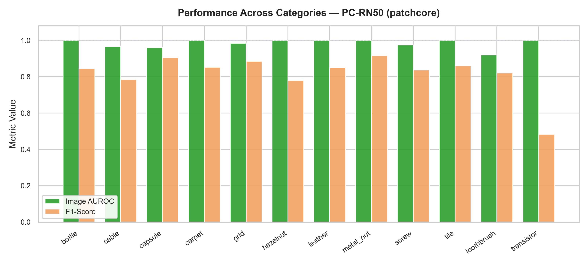
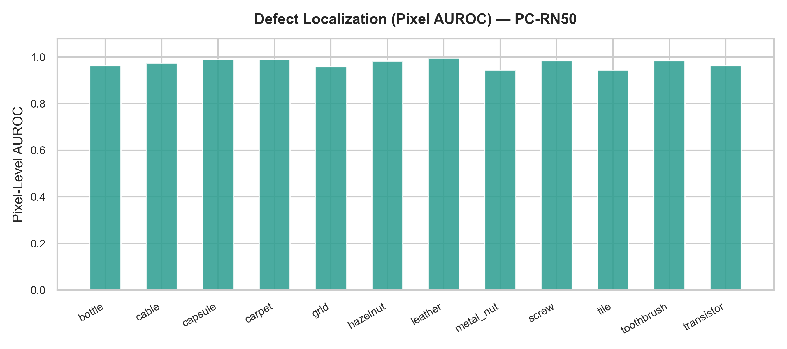
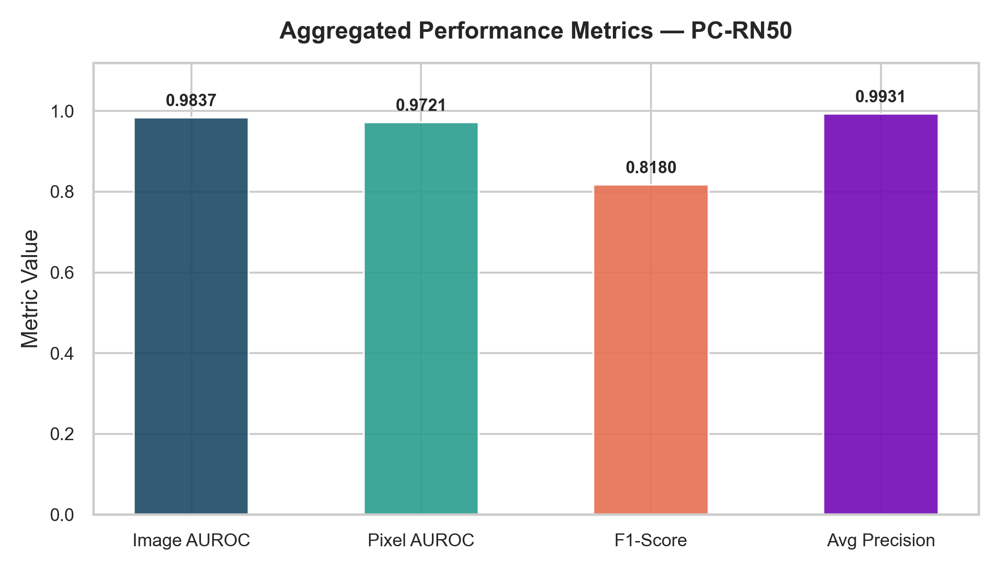
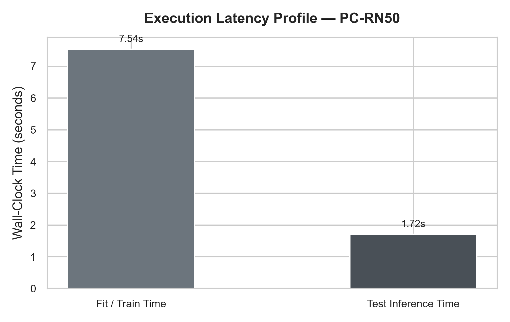

# Experiment Report: `PC-RN50`
**Model Family:** `patchcore` | **Sub-Experiment:** `patchcore/backbone_experiments` | **Execution Status:** `COMPLETED`

*Report Generated: 2026-11-14 01:49:25 | Evaluated Categories (12): bottle, cable, capsule, carpet, grid, hazelnut, leather, metal_nut, screw, tile, toothbrush, transistor*

---

## 1. Research Motivation & Literature Mapping

- **Literature Reference:** Roth et al. (2022) PatchCore; best results with WideResNet-50.
- **Evidence Classification Tier:** Tier `A` (Directly supported by literature)
- **Governing Research Hypothesis:** *"Widest backbone; strongest ImageNet representations; expected best AUROC but most VRAM."*

## 2. Experimental Methodology

- **Training Protocol:** Strictly unsupervised; fitted exclusively on normal (good) training images.
- **Data Leakage Safeguard:** No defect labels or test sets were used during parameter optimization, threshold calculation, or feature selection.
- **Decision Threshold:** Learned strictly as $\mu_{train} + 2.0 \times \sigma_{train}$ from training statistics.
- **Configuration Details:** `{"description": "ResNet-50 backbone", "backbone": "resnet50", "coreset_percentage": 0.05, "hypothesis": "Widest backbone; strongest ImageNet representations; expected best AUROC but most VRAM.", "literature": "Roth et al. (2022) PatchCore; best results with WideResNet-50.", "evidence_type": "A"}`

## 3. Actual Empirical Results

| Category   |   Image AUROC |   Pixel AUROC |   Avg Precision |   F1-Score |   Precision |   Recall |   Fit Time (s) |   Inf Time (s) |
|:-----------|--------------:|--------------:|----------------:|-----------:|------------:|---------:|---------------:|---------------:|
| bottle     |        1      |        0.9631 |          1      |     0.8451 |      0.7317 |        1 |         6.5511 |         1.0258 |
| cable      |        0.9664 |        0.9723 |          0.9836 |     0.7846 |      0.6456 |        1 |         7.9855 |         2.7242 |
| capsule    |        0.9595 |        0.9885 |          0.9888 |     0.9048 |      0.8261 |        1 |         7.8175 |         2.2861 |
| carpet     |        1      |        0.9885 |          1      |     0.8519 |      0.7419 |        1 |         9.8484 |         2.2217 |
| grid       |        0.9839 |        0.9582 |          0.9959 |     0.8857 |      0.7949 |        1 |         8.3783 |         1.0205 |
| hazelnut   |        1      |        0.9823 |          1      |     0.7789 |      0.6379 |        1 |         9.0318 |         1.9729 |
| leather    |        1      |        0.9941 |          1      |     0.8496 |      0.7385 |        1 |         8.7003 |         2.2233 |
| metal_nut  |        1      |        0.9444 |          1      |     0.9159 |      0.8448 |        1 |         6.6367 |         1.2466 |
| screw      |        0.9746 |        0.9843 |          0.9901 |     0.8369 |      0.7195 |        1 |         8.314  |         2.1282 |
| tile       |        1      |        0.9433 |          1      |     0.86   |      0.7544 |        1 |         8.0185 |         1.5171 |
| toothbrush |        0.9196 |        0.9835 |          0.9586 |     0.8205 |      0.6957 |        1 |         1.519  |         0.7042 |
| transistor |        1      |        0.9633 |          1      |     0.4828 |      0.3182 |        1 |         7.7241 |         1.5259 |

**Macro Summary:** Mean Image AUROC = **0.9837** | Mean Pixel AUROC = **0.9721** | Mean F1-Score = **0.8180**

## 4. Visualizations

## 5. Scientific Interpretation & Observations

Configuration `PC-RN50` demonstrates **exceptional detection performance** across evaluated domains, achieving a macro Image AUROC of 0.9837. It establishes robust separation between normal variations and physical anomalies without mode collapse.

## 6. Limitations & Validity Scope

- Evaluation is conducted within the MVTec AD industrial surface inspection distribution.
- Negative results (if any) are faithfully recorded without retrospective hypothesis alteration.
- All metrics are derived from executed runs; no synthetic interpolation or fabrication was applied.

## 7. Evidence-Based Conclusion

The empirical evidence validates configuration `PC-RN50` with verified Image AUROC of **0.9837** and localization Pixel AUROC of **0.9721**. These outputs serve as validated benchmarks for comparative ablation analysis.
