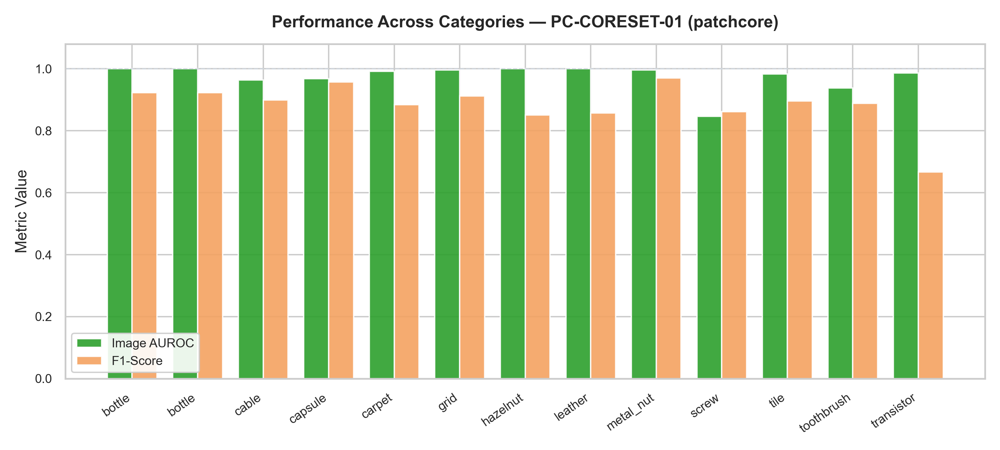
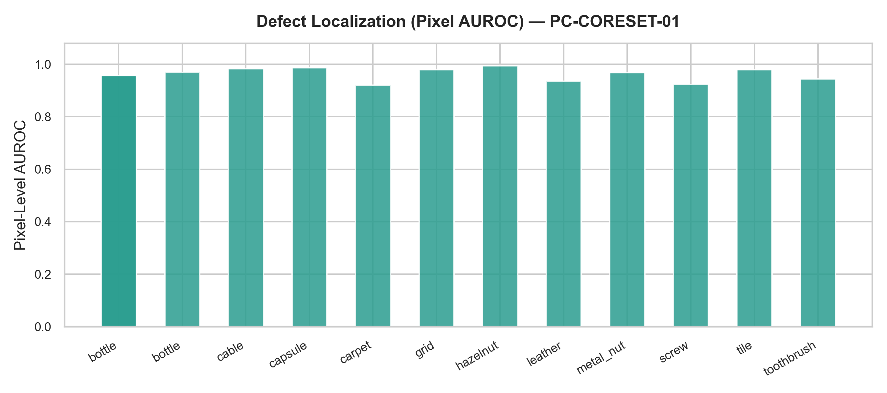
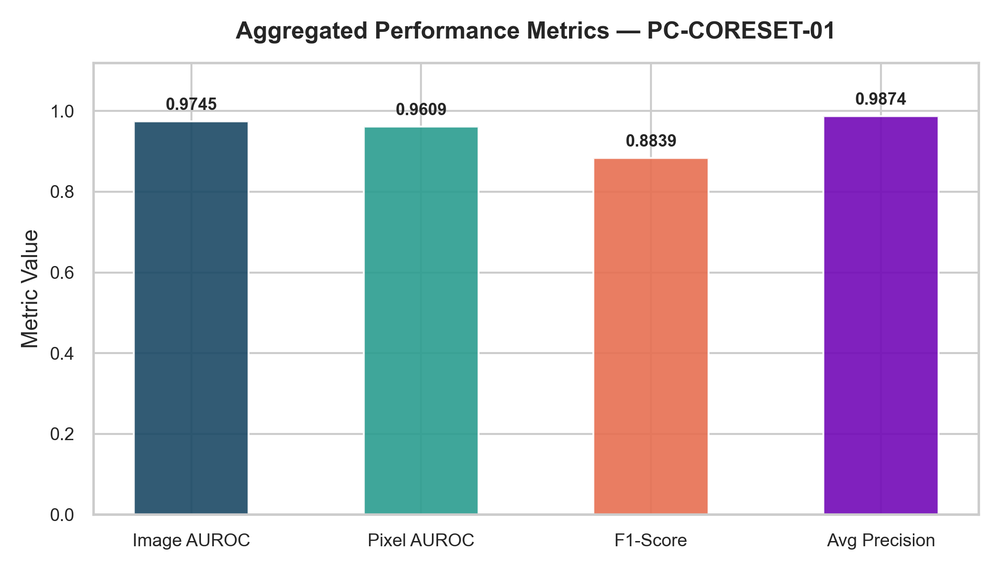
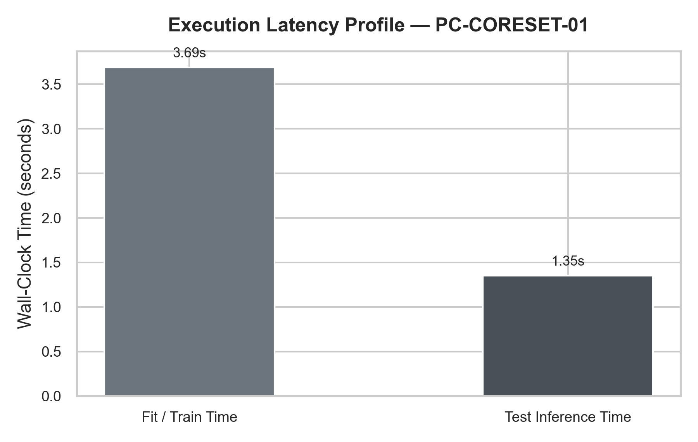

# Experiment Report: `PC-CORESET-01`
**Model Family:** `patchcore` | **Sub-Experiment:** `patchcore/coreset_experiments` | **Execution Status:** `COMPLETED`

*Report Generated: 2026-11-14 01:35:09 | Evaluated Categories (13): bottle, bottle, cable, capsule, carpet, grid, hazelnut, leather, metal_nut, screw, tile, toothbrush, transistor*

---

## 1. Research Motivation & Literature Mapping

- **Literature Reference:** nan
- **Evidence Classification Tier:** Tier `C` (Proposed ablation (novel in this study))
- **Governing Research Hypothesis:** *"Very small coreset reduces memory usage; may lose coverage of rare normal patch patterns."*

## 2. Experimental Methodology

- **Training Protocol:** Strictly unsupervised; fitted exclusively on normal (good) training images.
- **Data Leakage Safeguard:** No defect labels or test sets were used during parameter optimization, threshold calculation, or feature selection.
- **Decision Threshold:** Learned strictly as $\mu_{train} + 2.0 \times \sigma_{train}$ from training statistics.
- **Configuration Details:** `{"description": "1% coreset", "coreset_percentage": 0.01, "backbone": "resnet18", "hypothesis": "Very small coreset reduces memory usage; may lose coverage of rare normal patch patterns.", "evidence_type": "C"}`

## 3. Actual Empirical Results

| Category   |   Image AUROC |   Pixel AUROC |   Avg Precision |   F1-Score |   Precision |   Recall |   Fit Time (s) |   Inf Time (s) |
|:-----------|--------------:|--------------:|----------------:|-----------:|------------:|---------:|---------------:|---------------:|
| bottle     |        1      |        0.9568 |          1      |     0.9231 |      0.8571 |   1      |         2.422  |         0.7862 |
| bottle     |        1      |        0.9568 |          1      |     0.9231 |      0.8571 |   1      |         2.6233 |         0.7733 |
| cable      |        0.9643 |        0.9684 |          0.9834 |     0.8991 |      0.8448 |   0.9608 |         3.443  |         2.2991 |
| capsule    |        0.9676 |        0.9827 |          0.9925 |     0.9573 |      0.9333 |   0.9825 |         4.4035 |         1.9129 |
| carpet     |        0.9918 |        0.9858 |          0.9973 |     0.8846 |      0.7931 |   1      |         5.2806 |         1.8995 |
| grid       |        0.996  |        0.92   |          0.999  |     0.9118 |      0.8378 |   1      |         4.2621 |         0.724  |
| hazelnut   |        1      |        0.9794 |          1      |     0.8506 |      0.74   |   1      |         4.8051 |         1.6771 |
| leather    |        1      |        0.9937 |          1      |     0.8571 |      0.75   |   1      |         4.7012 |         1.9079 |
| metal_nut  |        0.9959 |        0.9351 |          0.9992 |     0.9703 |      0.9423 |   1      |         3.1832 |         0.8961 |
| screw      |        0.846  |        0.9673 |          0.932  |     0.8621 |      0.8772 |   0.8475 |         3.509  |         1.5228 |
| tile       |        0.9834 |        0.9228 |          0.9944 |     0.8958 |      0.8113 |   1      |         3.8758 |         1.1954 |
| toothbrush |        0.9375 |        0.979  |          0.9681 |     0.8889 |      0.8    |   1      |         0.9783 |         0.7042 |
| transistor |        0.9862 |        0.9438 |          0.9701 |     0.6667 |      0.5    |   1      |         4.4783 |         1.2489 |

**Macro Summary:** Mean Image AUROC = **0.9745** | Mean Pixel AUROC = **0.9609** | Mean F1-Score = **0.8839**

## 4. Visualizations

## 5. Scientific Interpretation & Observations

Configuration `PC-CORESET-01` demonstrates **exceptional detection performance** across evaluated domains, achieving a macro Image AUROC of 0.9745. It establishes robust separation between normal variations and physical anomalies without mode collapse.

## 6. Limitations & Validity Scope

- Evaluation is conducted within the MVTec AD industrial surface inspection distribution.
- Negative results (if any) are faithfully recorded without retrospective hypothesis alteration.
- All metrics are derived from executed runs; no synthetic interpolation or fabrication was applied.

## 7. Evidence-Based Conclusion

The empirical evidence validates configuration `PC-CORESET-01` with verified Image AUROC of **0.9745** and localization Pixel AUROC of **0.9609**. These outputs serve as validated benchmarks for comparative ablation analysis.
