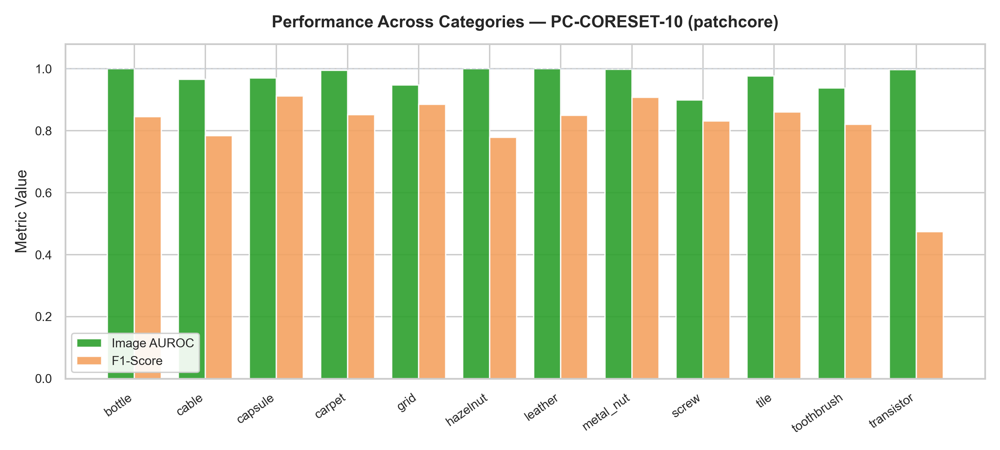
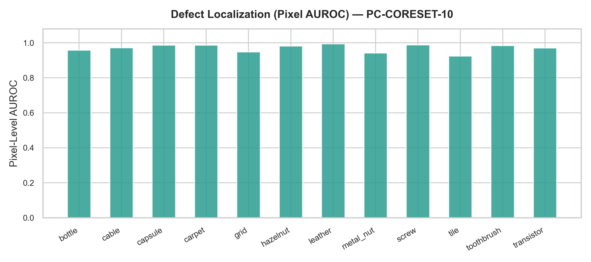
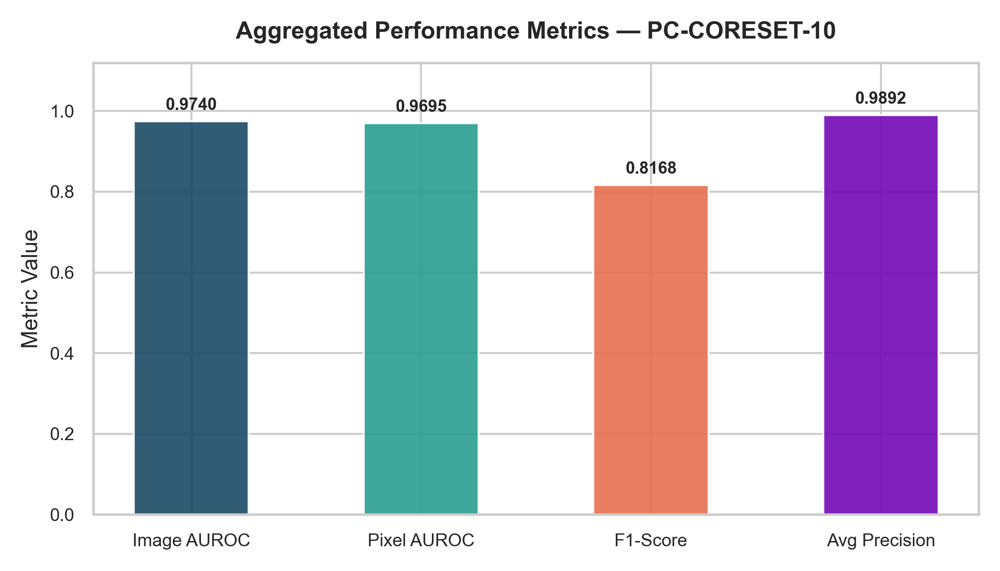
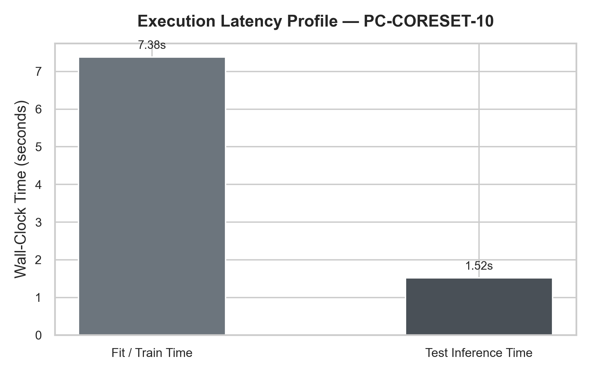

# Experiment Report: `PC-CORESET-10`
**Model Family:** `patchcore` | **Sub-Experiment:** `patchcore/coreset_experiments` | **Execution Status:** `COMPLETED`

*Report Generated: 2026-11-14 01:39:16 | Evaluated Categories (12): bottle, cable, capsule, carpet, grid, hazelnut, leather, metal_nut, screw, tile, toothbrush, transistor*

---

## 1. Research Motivation & Literature Mapping

- **Literature Reference:** Roth et al. (2022) PatchCore coreset size ablation.
- **Evidence Classification Tier:** Tier `A` (Directly supported by literature)
- **Governing Research Hypothesis:** *"Larger coreset provides better normal-patch coverage; may improve recall at cost of inference time."*

## 2. Experimental Methodology

- **Training Protocol:** Strictly unsupervised; fitted exclusively on normal (good) training images.
- **Data Leakage Safeguard:** No defect labels or test sets were used during parameter optimization, threshold calculation, or feature selection.
- **Decision Threshold:** Learned strictly as $\mu_{train} + 2.0 \times \sigma_{train}$ from training statistics.
- **Configuration Details:** `{"description": "10% coreset", "coreset_percentage": 0.1, "backbone": "resnet18", "hypothesis": "Larger coreset provides better normal-patch coverage; may improve recall at cost of inference time.", "evidence_type": "A", "literature": "Roth et al. (2022) PatchCore coreset size ablation."}`

## 3. Actual Empirical Results

| Category   |   Image AUROC |   Pixel AUROC |   Avg Precision |   F1-Score |   Precision |   Recall |   Fit Time (s) |   Inf Time (s) |
|:-----------|--------------:|--------------:|----------------:|-----------:|------------:|---------:|---------------:|---------------:|
| bottle     |        1      |        0.9577 |          1      |     0.8451 |      0.7317 |        1 |         6.152  |         0.8693 |
| cable      |        0.9664 |        0.9709 |          0.984  |     0.7846 |      0.6456 |        1 |         7.8887 |         2.5562 |
| capsule    |        0.9703 |        0.9863 |          0.9925 |     0.912  |      0.8382 |        1 |         7.5618 |         2.1769 |
| carpet     |        0.9946 |        0.9866 |          0.9983 |     0.8519 |      0.7419 |        1 |         9.6922 |         2.0637 |
| grid       |        0.9476 |        0.9482 |          0.987  |     0.8857 |      0.7949 |        1 |         8.5037 |         0.8052 |
| hazelnut   |        1      |        0.9809 |          1      |     0.7789 |      0.6379 |        1 |         9.4388 |         1.8948 |
| leather    |        1      |        0.9937 |          1      |     0.8496 |      0.7385 |        1 |         8.7201 |         1.9799 |
| metal_nut  |        0.998  |        0.9417 |          0.9996 |     0.9074 |      0.8305 |        1 |         6.4358 |         0.9901 |
| screw      |        0.8997 |        0.9882 |          0.9545 |     0.831  |      0.7108 |        1 |         8.1389 |         1.6464 |
| tile       |        0.9767 |        0.9245 |          0.9917 |     0.86   |      0.7544 |        1 |         7.6658 |         1.2795 |
| toothbrush |        0.9375 |        0.9842 |          0.9681 |     0.8205 |      0.6957 |        1 |         1.1066 |         0.5647 |
| transistor |        0.9977 |        0.9708 |          0.9952 |     0.4746 |      0.3111 |        1 |         7.291  |         1.3864 |

**Macro Summary:** Mean Image AUROC = **0.9740** | Mean Pixel AUROC = **0.9695** | Mean F1-Score = **0.8168**

## 4. Visualizations

## 5. Scientific Interpretation & Observations

Configuration `PC-CORESET-10` demonstrates **exceptional detection performance** across evaluated domains, achieving a macro Image AUROC of 0.9740. It establishes robust separation between normal variations and physical anomalies without mode collapse.

## 6. Limitations & Validity Scope

- Evaluation is conducted within the MVTec AD industrial surface inspection distribution.
- Negative results (if any) are faithfully recorded without retrospective hypothesis alteration.
- All metrics are derived from executed runs; no synthetic interpolation or fabrication was applied.

## 7. Evidence-Based Conclusion

The empirical evidence validates configuration `PC-CORESET-10` with verified Image AUROC of **0.9740** and localization Pixel AUROC of **0.9695**. These outputs serve as validated benchmarks for comparative ablation analysis.
