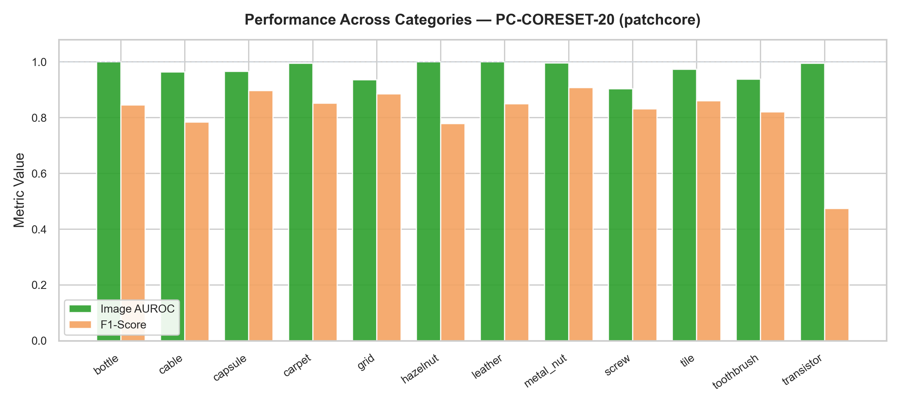
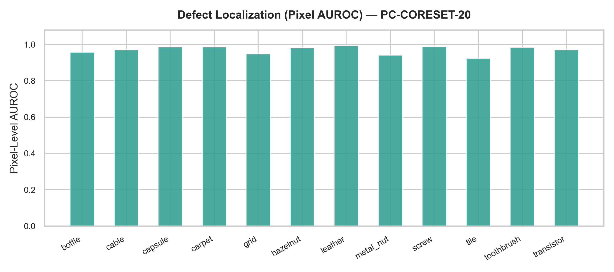
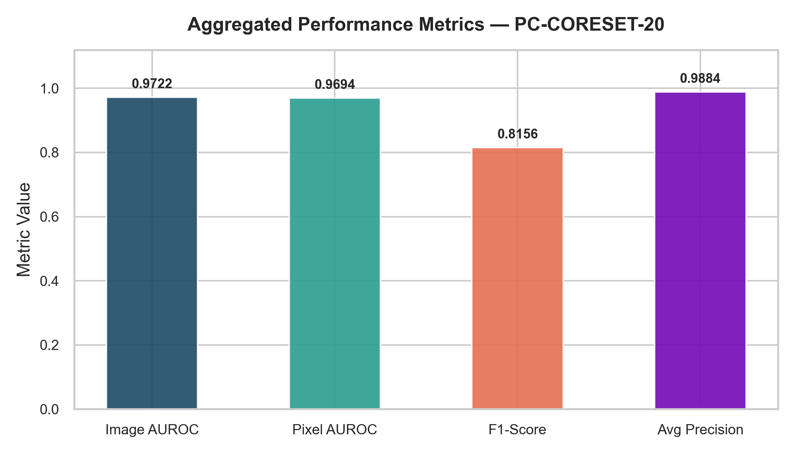
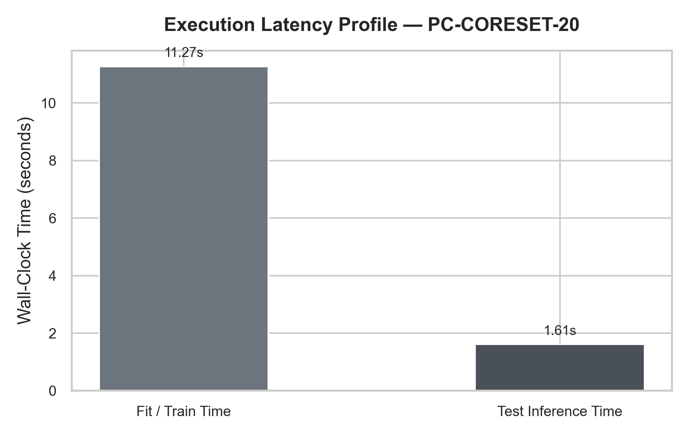

# Experiment Report: `PC-CORESET-20`
**Model Family:** `patchcore` | **Sub-Experiment:** `patchcore/coreset_experiments` | **Execution Status:** `COMPLETED`

*Report Generated: 2026-11-14 01:41:48 | Evaluated Categories (12): bottle, cable, capsule, carpet, grid, hazelnut, leather, metal_nut, screw, tile, toothbrush, transistor*

---

## 1. Research Motivation & Literature Mapping

- **Literature Reference:** nan
- **Evidence Classification Tier:** Tier `B` (Literature-inspired / architectural extension)
- **Governing Research Hypothesis:** *"Large coreset; memory and speed tradeoff; establishes performance ceiling for coreset size."*

## 2. Experimental Methodology

- **Training Protocol:** Strictly unsupervised; fitted exclusively on normal (good) training images.
- **Data Leakage Safeguard:** No defect labels or test sets were used during parameter optimization, threshold calculation, or feature selection.
- **Decision Threshold:** Learned strictly as $\mu_{train} + 2.0 \times \sigma_{train}$ from training statistics.
- **Configuration Details:** `{"description": "20% coreset", "coreset_percentage": 0.2, "backbone": "resnet18", "hypothesis": "Large coreset; memory and speed tradeoff; establishes performance ceiling for coreset size.", "evidence_type": "B"}`

## 3. Actual Empirical Results

| Category   |   Image AUROC |   Pixel AUROC |   Avg Precision |   F1-Score |   Precision |   Recall |   Fit Time (s) |   Inf Time (s) |
|:-----------|--------------:|--------------:|----------------:|-----------:|------------:|---------:|---------------:|---------------:|
| bottle     |        1      |        0.9578 |          1      |     0.8451 |      0.7317 |        1 |         9.5938 |         0.9586 |
| cable      |        0.9643 |        0.971  |          0.9832 |     0.7846 |      0.6456 |        1 |        11.4135 |         2.6278 |
| capsule    |        0.9663 |        0.9861 |          0.9917 |     0.8976 |      0.8143 |        1 |        11.3663 |         2.1974 |
| carpet     |        0.9946 |        0.9867 |          0.9982 |     0.8519 |      0.7419 |        1 |        14.3814 |         2.1226 |
| grid       |        0.9355 |        0.9476 |          0.9838 |     0.8857 |      0.7949 |        1 |        13.6378 |         0.8988 |
| hazelnut   |        1      |        0.9808 |          1      |     0.7789 |      0.6379 |        1 |        13.9539 |         1.9038 |
| leather    |        1      |        0.9937 |          1      |     0.8496 |      0.7385 |        1 |        13.1283 |         2.1071 |
| metal_nut  |        0.9959 |        0.9409 |          0.9992 |     0.9074 |      0.8305 |        1 |         9.985  |         1.121  |
| screw      |        0.9032 |        0.988  |          0.9555 |     0.831  |      0.7108 |        1 |        13.5841 |         1.916  |
| tile       |        0.9734 |        0.9242 |          0.9911 |     0.86   |      0.7544 |        1 |        11.9207 |         1.4204 |
| toothbrush |        0.9375 |        0.9843 |          0.9681 |     0.8205 |      0.6957 |        1 |         1.3094 |         0.5857 |
| transistor |        0.9954 |        0.9715 |          0.9901 |     0.4746 |      0.3111 |        1 |        10.9812 |         1.4522 |

**Macro Summary:** Mean Image AUROC = **0.9722** | Mean Pixel AUROC = **0.9694** | Mean F1-Score = **0.8156**

## 4. Visualizations

## 5. Scientific Interpretation & Observations

Configuration `PC-CORESET-20` demonstrates **exceptional detection performance** across evaluated domains, achieving a macro Image AUROC of 0.9722. It establishes robust separation between normal variations and physical anomalies without mode collapse.

## 6. Limitations & Validity Scope

- Evaluation is conducted within the MVTec AD industrial surface inspection distribution.
- Negative results (if any) are faithfully recorded without retrospective hypothesis alteration.
- All metrics are derived from executed runs; no synthetic interpolation or fabrication was applied.

## 7. Evidence-Based Conclusion

The empirical evidence validates configuration `PC-CORESET-20` with verified Image AUROC of **0.9722** and localization Pixel AUROC of **0.9694**. These outputs serve as validated benchmarks for comparative ablation analysis.
